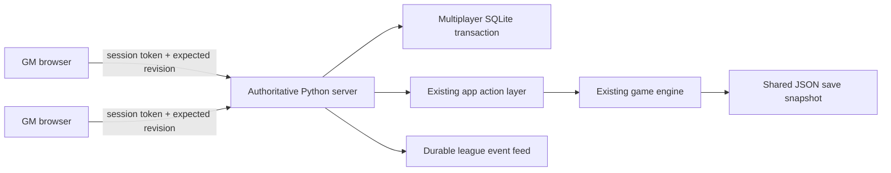

# Multiplayer Architecture

## Goal

Multiplayer adds distributed coordination without duplicating basketball rules. The existing Python simulation remains authoritative. Browsers request actions and render JSON; they never decide whether a trade, signing, pick, or roster move is legal.

## Runtime Shape

The first deployment target is one server process with a persistent filesystem. SQLite coordinates lobbies, managers, clocks, revisions, idempotency responses, human trade offers, and notifications. The existing JSON save remains the rich game snapshot.

## Lobby And Identity

- A lobby has a human-safe six-character code.
- The code finds a lobby; it is not authentication.
- Each manager receives a private random session token. Only its SHA-256 hash is stored.
- A partial unique database index guarantees one human manager per team.
- Lobby capacity is 30 managers. Starting requires at least two, a team for everyone, and every manager marked ready.
- AI retains control of all teams absent from `meta.human_team_ids`.

## Concurrency Contract

Every shared mutation carries:

1. `expected_revision`: the revision the browser rendered.
2. `idempotency_key`: a unique ID reused when retrying the same request.
3. The authenticated manager identity.

The server begins a SQLite `BEGIN IMMEDIATE` transaction, verifies the session and revision, applies the existing engine action, atomically updates the save revision, appends an event, stores the response under the idempotency key, and commits. A stale revision receives HTTP `409` plus the current revision. A repeated idempotency key receives the original response.

The JSON save is backed up before a mutation and restored atomically if the engine or database operation fails. This is intentionally conservative: correctness is more important than making simultaneous clicks appear instantaneous.

## Human-To-Human Trades

Human trades are bilateral:

1. The proposing browser submits its candidate.
2. The server rebuilds the evaluation from the current save rather than trusting client-provided values.
3. The proposal is stored as pending and the other manager is notified.
4. On acceptance, the server verifies the latest league revision, forces neither asset nor legality result, and executes through the existing trade engine.
5. If an asset moved, protection changed, or the trade became illegal, the transaction is rejected without a partial save.

AI trades and AI offers continue to use the existing decision model. Human-controlled teams are removed from autonomous AI execution.

## Shared Clock

The host configures:

- standard rosters or an opening fantasy draft;
- weekly or monthly regular-season advancement;
- action-window duration;
- fantasy-draft pick duration;
- draft pick duration;
- free-agency round duration;
- dynasty season count.

Managers may ready up to advance before the deadline. Otherwise a scheduler advances when the deadline expires. All direct client calls to season, draft, free-agency, or playoff simulation actions are blocked.

Phase adapters perform one appropriate shared operation:

- Fantasy draft: one human choice or timed auto-pick; AI selections between human turns resolve immediately.
- Regular season: one week or one month.
- Draft: one pick; the team on the clock may use one limited extension.
- Free agency: one market day.
- Playoffs: one game in each active series.
- Completed phase: advance to the next phase.

## Dynasty Result

Completed championships are recorded once per save season. When the configured number of seasons is reached, the league is marked complete. Ranking is:

1. Championships.
2. Aggregate regular-season wins.
3. Fewer aggregate losses.

The large internal championship score only makes this ordering explicit; it is not a user-facing currency.

## Security Boundary

The alpha has session authentication and authorization, but it is not yet a public anonymous service:

- Run behind HTTPS before sending tokens over the internet.
- Add reverse-proxy request-size limits and rate limiting.
- Back up both `saves/.multiplayer.sqlite3` and multiplayer JSON saves together.
- Run one authoritative application instance unless storage is migrated to Postgres/object snapshots with distributed locks.
- Do not expose local filesystem paths in a later public API.
- Add account recovery before leagues become valuable enough that losing browser storage is unacceptable.

## Storage Migration

SQLite is the right first implementation because it is transactional, dependency-free, and easy to inspect. A hosted multi-instance version should replace the store with Postgres while keeping `MultiplayerService` and the game action layer unchanged. The JSON save should then move to versioned object storage or a Postgres JSONB snapshot, with one distributed lock per league.
