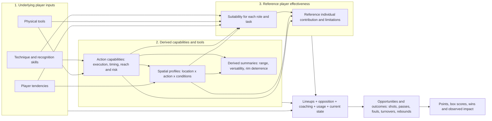

# Player object: explicit three-column dependency map

Status: user-approved target architecture and input/role catalogue, following review of the November 12 map. This is a design deliverable, not a description of already implemented mechanics. It supersedes the earlier 21-rating shortlist. No production ratings, simulation formulas, saves, UI or coaches are changed by this document.

## Approval and implementation contract

The user explicitly approved all 64 skill dimensions (46 non-passing plus 18 passing), all 12 physical families, all 18 tendency families, and the listed roles. Preserve every approved dimension and its meaning throughout implementation. Sparse evidence, implementation convenience or a desired smaller UI must not silently delete, merge or replace approved dimensions. A proposed substantive schema change requires explicit review.

The user reviewed derived capabilities more briefly and endorsed their general direction, not numerical formulas or weights. Their dependencies, double-counting boundaries and effects still require technical verification. Role suitability scales, reference OFF/DEF/OVR, coefficients, data estimates and engine calibration are not established merely by approving the catalogue.

Every approved input must have a tracked implementation status: definition, evidence/estimation, storage, gameplay consumer, presentation consumer and verification. A field present in a save but unused by gameplay is not finished. A shared statistical estimate may support multiple uncertain skill estimates, but does not erase their distinct meanings or imply independent measurement.

Preserve a single authoritative underlying player model. Any temporary old-engine adapter must be explicitly transitional and must not become a second independently editable/growing set of talents. Existing disposable development saves do not justify maintaining permanent legacy simulation behavior.

## Decisions carried forward

- Keep the three layers: underlying player inputs; derived capabilities and spatial profiles; role/task effectiveness and reference individual impact. Spatial profiles are central, not decorative heatmap data.
- Physical change of direction means movement capacity **without the ball**. With-ball redirection combines it with dribble control, security and technique. Do not award a second agility bonus after using a capability that already includes agility.
- Retain all twelve physical-tool entries below. They unpack the already approved physical families, rather than adding new ones.
- Every passing family below has its own recognition and execution rating. Limited evidence may mean shared estimates and wide uncertainty; it does not mean silently deleting a requested distinction.
- Route execution includes timing and deception. Those are components/evidence, not three independently additive bonuses.
- Keep recognition, movement and controlled execution as the ingredients of recovery. No four new recovery ratings.
- Heatmaps show regional shot frequency through polygon size and regional shooting efficiency through color, both relative to a declared league reference. They are a narrow view of a richer spatial model.
- Preserve underlying inputs and named derived ratings, including rim deterrence. Their information stays accessible; a downstream summary is not an extra bonus on top of its ingredients.

## The complete structure at a glance

Arrows mean information can be used, not that every connected number is added. Each outcome mechanism must declare which representation it consumes. If effective containment already includes agility, the same containment contest cannot add raw agility again. Raw agility can still control a separate travel-time calculation that containment did not include.

Columns 1-3 describe the player's **basketball-performance model**, not the entire persisted player record. Identity, contracts, injuries, development, scouting uncertainty, career records and other state are listed at the end. Teammate and opponent quality are not permanent player talents.

## Explicit three-column map

The IDs in this table resolve to the full inventories below. Within each row, column 1 feeds column 2; column 3 names the resulting jobs and contributions. Direct raw inputs are named again where they matter independently, rather than disappearing into one average.

| Column 1: raw skills, tools and tendencies | Column 2: derived capabilities and spatial information | Column 3: roles, tasks and reference contribution |
|---|---|---|
| S01-S09 shooting; P09 balance, P11 conditioning; T01-T04 shot choices | C01-C05 shooting curves, range and release windows; C31 offensive spatial profile; C34 versatility | R01 spacer, R02 movement shooter, R03 pull-up scorer; R21 scoring/spacing contribution, R22 summaries |
| S16-S20 handling, separation, driving and recognition; P05-P09 movement/strength; T01, T04-T06, T08 | C06 ball security, C07 separation, C08 paint access; C31 spatial access paths | R03 scorer, R04 advantage creator, R05 pick-and-roll handler; R21 creation and turnover exposure |
| S21-S23 post craft; S10-S12, S15 finishing; P01-P04, P08-P10 size/strength/balance/jump; T01, T02, T18 | C09 post advantage, C14 post scoring, C15 foul creation; C31 post locations and exit options | R06 post creator; R21 scoring, passing openings and foul pressure |
| S10-S15 finishing and catching; P01-P03, P08-P10; T01, T02, T18 | C10 layups, C11 floaters, C12 dunks/lobs, C13 receiving, C15 fouls; C31 finishing profile | R09 cutter, R10 roller, R13 transition finisher; R21 conversion of available chances |
| F01-F09 recognition/execution pairs; S17 security, S20 attack recognition; P02 reach, P08 strength where mechanically relevant; T01, T05-T07 | C16 passing matrix, C35 recognition/execution summaries; C31 origin-to-destination passing profile | R04 creator, R05 handler, R06 post hub, R07 connector, R08 short-roll playmaker, R13 transition passer; R21 teammate chance creation and passing losses |
| S25 cutting routes, S26 relocation routes; S14 receiving; P05-P07, P09-P12 movement and sustained workload; T09-T11 | C17 off-ball route effectiveness, C19 roll/pop receiving windows; C31 routes and availability | R01 spacer, R02 movement shooter, R09 cutter; R21 openings created without the ball |
| S27 screen technique, S28 screen-action reads; P01-P04, P08-P09 size/strength/balance; T11 | C18 screening, C19 roll/pop/slip effectiveness; C31 screen locations and follow-up routes | R10 screener/roller, R11 pick-and-pop big, R08 short-roll playmaker; R21 separation created for teammates |
| S29-S32 rebounding/box-outs; P01-P03, P05, P08-P10; T12-T13 | C20 offensive rebounding, C21 defensive rebounding, C22 box-out support; C31/C32 rebound coverage | R12 offensive rebounder; R21 extra possessions and defensive possession security, including teammate rebounds |
| S33 containment, S34 contact leverage, S41 anticipation, S45 foul control; P02, P05-P09; T17 effort | C23 containment, C24 contact resistance, C29 controlled execution; C32 pressure/containment profile | R14 point-of-attack defender, R15 wing stopper, R19 mobile big; R21 containment and foul exposure |
| S35 navigation, S41 route anticipation, S44 attention; P05-P09, P11-P12; T17 | C25 navigation/pursuit, C30 workload response; C32 pursuit paths | R14 point-of-attack defender, R16 movement chaser, R19 mobile big; R21 protection against screen-created advantages |
| S38 rotation recognition, S39 off-ball positioning, S40 closeouts, S44 attention, S46 communication; P02-P03, P05-P07, P09; T15 help commitment, T17 | C26 help/recovery, C29 discipline; C32 help origins, destinations and recovery coverage | R17 helper, R19 mobile big, R20 sheltered-assignment compatibility; R21 prevented openings and recovery costs |
| S36 interior positioning, S37 contest technique, S45 foul control; P01-P03, P05, P08-P10; T16 contest choice | C27 interior coverage/contests, C32 defensive spatial profile, C36 rim-deterrence summary | R18 rim anchor, R17 helper, R19 mobile big; R21 interior attempts discouraged/contested and associated foul risks |
| S42 on-ball steal technique, S43 interception technique, S41 anticipation, S44 attention, S45 foul control; P02, P05-P07; T14 gamble frequency, T15 help commitment | C28 disruption, C29 discipline; C32 interception/pressure profile | R14-R20 relevant defensive tasks; R21 steals, deflections and openings conceded |
| P11 conditioning, P12 recovery; T17 effort allocation; relevant task skills | C30 workload response, applied to task-specific capability | All roles: sustained execution, not an automatic bonus for previously playing many minutes |

## Column 1A: physical tools

Measurements stay in meaningful physical units where available. A displayed 0-100 grade can summarize a measurement, but must not replace the measurement used by geometry. Technique estimates below are intended to exclude physical advantages already represented here.

| ID | Tool | Precise meaning |
|---|---|---|
| P01 | Height | Standing body height; not skill or automatic defensive impact. |
| P02 | Wingspan | Arm-span measurement supporting reach geometry. |
| P03 | Standing reach | Measured overhead reach. If unavailable, estimate with uncertainty; do not add height and wingspan again as extra contest bonuses. |
| P04 | Body mass | Mass relevant to contact and inertia; not equivalent to functional strength. |
| P05 | Acceleration / first step | Rate of gaining movement speed, without the ball. |
| P06 | Straight-line speed | Attainable movement speed over distance. |
| P07 | Lateral mobility / change of direction | Without-ball lateral movement, braking and redirection capacity. Do not infer this directly from screen-navigation success. Separate lateral/COD observations may be retained beneath this family. |
| P08 | Functional strength | Capacity to apply/resist force. Contact leverage technique remains a separate skill. |
| P09 | Physical balance / stability | Capacity to maintain or regain bodily control. Learned footwork and decision quality are separate. |
| P10 | Vertical / jump capacity | Reach added by jumping. Standing reach + jump determines potential coverage; timing determines how effectively it is used. |
| P11 | Conditioning | Ability to sustain repeated workload before execution deteriorates. |
| P12 | Recovery between efforts | Rate of recovering from exertion during rest/lower-intensity periods. Not injury recovery or developmental resilience. |

These are twelve input families, not twelve promises of independently measured NBA-wide data. Repeated-jump technique, first-step direction splits and stronger/weaker-side differences can be observations or profiles before becoming additional independently stored ratings.

## Column 1B: raw technique and recognition skills

These are **proposed separate ability dimensions**, not a requirement to fit that many bars onto a player card. No independent global shooting, athleticism, scheme IQ, versatility, rim-deterrence or playoff-translation bonus sits alongside them. Those broad descriptions become summaries where justified.

Each skill needs a fixed reference scale, evidence, uncertainty and an explicit physical-inclusion definition. A provider's observed effectiveness grade cannot simply be renamed "technique only." Until physical/context separation is defensible, keep it as an effective observation constraining the derived capability; mark any inferred raw decomposition as uncertain.

### Shooting, finishing and creation

| ID | Raw skill | Meaning / boundary |
|---|---|---|
| S01 | Catch-and-shoot three-point execution | Shot preparation and accuracy from a catch at reference three-point distance. Not assumed equal to pull-up ability. |
| S02 | Pull-up three-point execution | Dribble pickup, shot footwork and accuracy from a live dribble at reference distance. |
| S03 | Movement three-point execution | Shooting while settling from substantial off-ball movement. Movement and catch labels can overlap; use a conditional model, not both full bonuses. |
| S04 | Catch-and-shoot midrange execution | Midrange catch preparation and accuracy. |
| S05 | Pull-up midrange execution | Midrange live-dribble shot execution. |
| S06 | Movement midrange execution | Midrange execution after off-ball movement; sparse evidence should remain visibly uncertain. |
| S07 | Free-throw execution | Uncontested free-throw shooting skill. Release speed is not an input to this talent. |
| S08 | Release / preparation technique | How quickly the player can prepare and release an appropriate shot without losing their usual mechanics. Actual release window also depends on the shot type and contest. |
| S09 | Distance-extension technique | Ability to preserve mechanics as distance increases beyond a reference shot. Derived usable range also requires sufficient accuracy and willingness; this is not a second universal accuracy bonus. |
| S10 | Layup / close-touch execution | Control, angle, touch and hand use on close attempts. Does not establish ability to get to the rim. |
| S11 | Floater / short-paint touch | Converting floaters and short-paint touch shots; distinct from explosive paint access. |
| S12 | Dunk execution | Takeoff coordination and ball control when a dunk is physically available. Reach/vertical determine availability, not this skill alone. |
| S13 | Aerial catch-to-finish execution | Timing and coordination to receive and finish airborne chances. Combines with receiving and the appropriate finish, without treating every assisted basket as a lob. |
| S14 | Receiving / catch control | Securing and preparing to use an incoming pass, including difficult deliveries. |
| S15 | Contact finishing technique | Protecting the ball, adjusting and preserving finish control through contact. Strength contributes separately to effective contact tolerance. |
| S16 | Dribble manipulation | Ball control through changes of hand, direction, speed and dribble moves. Does not itself confer physical speed. |
| S17 | Handle security | Protecting possession against pressure. Must directly influence ball-loss risk at comparable exposure. |
| S18 | Perimeter separation craft | Footwork, fakes, counters and deception that create shot or attack space. Complements dribble manipulation, rather than measuring the same moves twice. |
| S19 | Driving craft | Choosing/maintaining attack angles, using the defender's hip, changing pace and exploiting lanes. |
| S20 | Attack recognition | Recognizing when to shoot, drive, post, reset or move the advantage. Specific passing reads live in F01-F09. |
| S21 | Post establishment / sealing | Technique to gain and retain useful receiving/post position. |
| S22 | Post moves / counters | Footwork, fakes and counters to create a post advantage. |
| S23 | Post-specific finish execution | Hooks and other post-specific release techniques. A generic layup or jumper from the post still uses its own shot skill, not two full accuracy ratings. |
| S24 | Foul-drawing craft | Timing and body/ball placement that draw legal contact during an available attack. Does not create free throws without an attack and defender interaction. |

### Off-ball play, screens and rebounds

| ID | Raw skill | Meaning / boundary |
|---|---|---|
| S25 | Cutting-route execution | Timing, deception, route choice and presenting a usable receiving window. Speed is supplied by physical tools; frequency by tendencies/assignments. |
| S26 | Relocation / shooting-route execution | Timing and disguising relocation, using screens and arriving prepared to shoot. The subsequent shot uses S01-S06 as appropriate. |
| S27 | Screen execution | Screen angle, placement, legal positioning and contact technique. Body size/strength do not automatically establish competence. |
| S28 | Screen-action recognition | Recognizing when to hold, re-screen, slip, roll or pop. Passing after the catch uses the relevant passing family. |
| S29 | Offensive rebound reading / pursuit technique | Reading shot trajectory, finding a route and establishing offensive rebounding position. Not simply observed offensive rebounds. |
| S30 | Defensive rebound reading / positioning | Reading misses and securing advantageous defensive rebounding position. |
| S31 | Box-out technique | Finding an opponent, gaining legal leverage and maintaining a seal. Can create a teammate's rebound. |
| S32 | Rebound control | Timing and controlling/tipping a reachable ball. Reach, jump and strength are supplied separately. |

### Defensive technique and recognition

| ID | Raw skill | Meaning / boundary |
|---|---|---|
| S33 | On-ball containment technique | Stance, angles, footwork and spacing to keep an assignment contained. Effective containment also needs movement tools. |
| S34 | Contact resistance / leverage technique | Absorbing, redirecting and resisting contact through technique; physical strength and balance remain distinct. |
| S35 | Screen-navigation technique | Approach, body positioning and route technique around screens. Not another copy of lateral speed. |
| S36 | Interior positioning | Establishing depth/angle relative to the rim, ball, attacker and roller. Specifically interior, not every kind of defensive positioning. |
| S37 | Contest technique | Timing, hand/body placement and controlled vertical execution to challenge a shot. Shot context selects the relevant response; blocks are possible outcomes, not a second skill bonus. |
| S38 | Rotation recognition | Identifying help responsibilities, tags, switches and the next threat early enough to act. |
| S39 | Off-ball coverage positioning | Executing useful gap, denial, tag and recovery starting positions away from the primary matchup. Distinct from interior positioning, with legitimate overlap in evidence. |
| S40 | Closeout / arrival control | Approaching under control, managing angle/distance and avoiding an easy blow-by or foul. Physical travel speed is separate. |
| S41 | Defensive anticipation | Reading handler cues, passing windows and movement routes. It informs several tasks, but does not duplicate their execution skills. |
| S42 | On-ball steal technique | Timing and placement of hands to dislodge or take the ball. |
| S43 | Passing-lane interception technique | Executing interceptions and deflections of reachable passes. Recognition and reach also matter. |
| S44 | Attention / responsibility execution | Maintaining awareness of ball, assignment and coverage responsibilities. Not identical to intelligence or voluntary effort. |
| S45 | Foul-control technique | Maintaining legal contact/contest execution in difficult actions. Intentional tactical fouls are a separate decision. |
| S46 | Defensive communication | Recognizing and delivering useful coverage calls. Proposed team-coordination skill, not a personality/leadership rating or a universal defense bonus. Evidence may be scouting-led. |

### Passing: two raw ratings for every family

Recognition means noticing and selecting the useful pass/window, including its timing and risk. Execution means delivering the intended ball with appropriate placement, trajectory, pace and deception. A clever read can have a poor delivery; an accurate passer can miss the read.

| ID | Passing family | Recognition rating | Execution rating |
|---|---|---|---|
| F01 | Connector / swing / reversal | Identify the next useful continuation or ball reversal | Deliver the continuation accurately and on time |
| F02 | Post entry | Read the seal, denial and entry window | Place the entry where the receiver can secure/use it |
| F03 | Pocket / roll feed | Read roller availability, coverage and the gap | Deliver through the gap at the receiver's useful height/pace |
| F04 | Lob | Identify aerial availability and help timing | Place trajectory/timing for a usable aerial finish |
| F05 | Short-roll playmaking | Read the advantage after the screener catches in space | Deliver the appropriate pass from that short-roll situation |
| F06 | Drive-and-kick | Read help commitment and the perimeter outlet | Deliver accurately while driving or exiting the drive |
| F07 | Skip / cross-court | Identify a useful weak-side window beyond nearer receivers | Deliver across the defense with appropriate pace/trajectory |
| F08 | Post playmaking | Read cutters, doubles and outlets from the post | Deliver out of post position, including constrained body angles |
| F09 | Transition / outlet / advance | Recognize an available advantage upcourt | Deliver an accurate moving/long advance or outlet |

Each family has explicit fields `<family>.recognition` and `<family>.execution`: **18 ratings**, not nine averages. These are contexts with overlapping mechanics, not nine mutually exclusive event types. A short-roll skip pass is both F05-context and F07-route. Its model must use a declared shared baseline plus context-specific residual, or another explicitly non-additive combination; it must not add two complete passing talents. A lob from the post has the same issue. Broad passing recognition/execution summaries are derived, not extra inputs.

Recognition includes understanding options; T07 controls willingness to accept risk. Strong recognition does not force perfect decisions on every possession. Physical throw/reach limitations constrain delivery where relevant but cannot be added twice to evidence already measuring effective delivery.

## Column 1C: player tendencies

These are preferences or conditional attempt rates, not talent grades and not moral judgments. Many are distributions, not a single 0-100 number. Store baseline player preferences separately from coach instructions and realized frequencies.

| ID | Tendency | Representation / distinction |
|---|---|---|
| T01 | Shoot / drive / pass / post / reset choices | Conditional action distribution given the available options. |
| T02 | Shot-location preferences | Spatial attempt preferences, including side/region tendencies. Not regional accuracy. |
| T03 | Shooting-mode preferences | Catch, pull-up and movement attempt preferences conditional on opportunity. |
| T04 | Shot difficulty tolerance | Willingness to attempt contested, early or difficult shots; game state modifies the decision. |
| T05 | Pace / early-attack preference | Preference to advance or attack before the defense is set. |
| T06 | Dribble / possession persistence | Preference to retain the ball and continue probing rather than move it. |
| T07 | Passing risk appetite | Willingness to attempt difficult/high-reward deliveries. Not pass recognition or accuracy. |
| T08 | Offensive involvement preference | Tendency to seek touches/initiations. Actual usage is limited by coach plans, teammates and opportunity. |
| T09 | Cutting frequency | How often the player seeks a cut when opportunities arise. |
| T10 | Relocation / off-ball movement frequency | How often the player seeks another receiving/shooting location. |
| T11 | Screen / roll / pop / slip preferences | Conditional mix of screen actions and follow-ups. |
| T12 | Offensive crash versus retreat | Preference to pursue a miss versus recover defensively. Skill and coach strategy determine whether this is useful. |
| T13 | Defensive pursuit versus box-out emphasis | How the player allocates attention between collecting and securing space for others. Not a choice to abandon all rebounding. |
| T14 | Steal / disruption gamble frequency | Attempt appetite at a given apparent opening. Separate from execution and anticipation. |
| T15 | Help commitment | Willingness to leave an assignment, stunt or commit to help within the scheme. |
| T16 | Contest commitment / stay-down preference | Choice to jump, contest conservatively or preserve position. Technique governs the consequences. |
| T17 | Effort allocation | Offensive, defensive and transition workload choices. Conditioning limits sustainability; high offensive usage is not automatic proof of defensive laziness. |
| T18 | Contact-seeking preference | Whether the player seeks contact or avoids it while attacking. Foul-drawing and contact finishing are separate skills. |

Defensive assignment (anchor, helper, POA, etc.), minutes, matchup, scheme, intentional fouls, timeout/rest choices and the team's crash instructions belong to the **coach/game context**, not this list. Tendencies can respond to instructions without being silently overwritten by them.

## Column 2: derived capabilities, summaries and spatial tools

These are functions/profiles of the raw inputs, not separately trained talent stores. Dependencies below name the inputs needed to specify each capability. Reference opposition/opportunity conditions must be declared before assigning a numeric grade. Use the same definitions for imported players and generated prospects.

| ID | Derived object | Inputs and output |
|---|---|---|
| C01 | Catch-shooting response | S01, S04, S08, S09, P09 -> distance/contest/preparation response for catch shots. |
| C02 | Pull-up response | S02, S05, S08, S09, P09 -> distance/contest/preparation response for live-dribble shots. Separation availability is C07, not another accuracy bonus. |
| C03 | Movement-shooting response | S03, S06, S08, S09, P09 -> execution after movement; actual routes come from C17. |
| C04 | Free-throw conversion | S07 -> reference free-throw conversion. Current fatigue can affect execution downstream, not redefine free-throw talent. |
| C05 | Release window and usable range | S01-S06, S08-S09, P09 -> preparation time and distance at which each shot remains credible. Free-throw skill is excluded. Readouts of the same shooting model, not added to C01-C03 again. |
| C06 | Ball security under pressure | S16, S17, P08, P09 -> loss risk across pressure/handling difficulty, with exposure specified. |
| C07 | Perimeter separation | S16, S18, S20, P05-P09 -> space/time created against a reference defender. |
| C08 | Paint access | S16, S17, S19, S20, P05-P09 -> ability to reach useful interior positions. |
| C09 | Post advantage creation | S21, S22, P01-P04, P08, P09 -> useful position/space created through post play. |
| C10 | Layup effectiveness | S10, S15, P02, P03, P08-P10 -> conversion response for available close chances. |
| C11 | Floater effectiveness | S11, P09 -> short-paint conversion response, conditional on angle/contest. |
| C12 | Dunk / lob-finish effectiveness | S12-S15, P02, P03, P08-P10 -> reachable finishes, airborne control and conversion. |
| C13 | Receiving reliability | S14, P02, P09 -> securing/using a delivery given its quality and pressure. |
| C14 | Post scoring profile | C09, S23, C01, C02, C10, C11 -> outcomes for the chosen post finish/jumper. Select the applicable execution model; do not sum all finishing skills. |
| C15 | Foul-creation capability | S24, C08, C09, P08, P09 -> contact opportunities and foul outcomes under stated defender behavior. T18 changes attempted contact, not craft. |
| C16 | Passing capability matrix | F01-F09, S17, P02, P08 -> separate recognition and delivery responses by origin, destination, pressure and route. Receiver quality is contextual, not the passer's talent. |
| C17 | Off-ball route effectiveness | S25, S26, P05-P07, P09 -> opening/arrival timing for cuts and relocations. Actual receiving uses C13; making the shot uses its own response. |
| C18 | Screening effectiveness | S27, S28, P01-P04, P08, P09 -> separation, legal contact and follow-up opportunities. |
| C19 | Roll / pop / slip availability | S28, C17, C18, P01-P03, P05, P09 -> receiving windows after a screen; scoring/passing use their existing capabilities. |
| C20 | Offensive rebound capability | S29, S32, P01-P03, P05, P08-P10 -> opportunity reach and collection/control response. |
| C21 | Defensive rebound capability | S30, S32, P01-P03, P05, P08-P10 -> defensive collection/control response. |
| C22 | Box-out support | S31, P04, P08, P09 -> space secured and opponent access denied, including teammate collection opportunities. |
| C23 | On-ball containment | S33, S34, S41, S45, P02, P05-P09 -> reference containment versus movement/contact threats. C24 explains the contact component, not an additional bonus. |
| C24 | Contact resistance | S34, P04, P08, P09 -> ability to hold/recover position through contact. |
| C25 | Screen navigation / pursuit | S35, S41, S44, P05-P09 -> navigation and reattachment time, including route anticipation. |
| C26 | Help / rotation / controlled recovery | S38-S41, S44, S46, P02, P03, P05-P07, P09 -> recognition delay, route, arrival timing and control. Interior contests then use C27. |
| C27 | Interior coverage and contest response | S36, S37, S45, P01-P03, P05, P08-P10 -> contest access/quality, blocks/alterations and foul risk by location. Geometry resolves reach; do not sum height, wingspan and standing reach as three independent bonuses. |
| C28 | Disruption capability | S41-S43, S45, P02, P05-P07 -> success, deflection and failure-cost responses for steal/interception attempts. |
| C29 | Responsibility and legal execution | S44-S46, S38, S40 -> missed-assignment/foul/coordination responses. These are shared mechanisms used by defensive tasks, not a global extra defense multiplier. |
| C30 | Workload response | P11, P12, T17 -> task effort costs, fatigue accumulation and recovery. Current fatigue belongs to state, not permanent talent. |
| C31 | Offensive spatial profile | C01-C03, C05-C22, T01-T13, T18 -> location/action capability, access routes, receiving/passing links and separate default usage preferences. See specification below. |
| C32 | Defensive spatial profile | C21-C29, C37, T13-T17 -> containment, contest, help, disruption and rebound coverage by location/action and reference responsibility. |
| C33 | Default action-choice profile | T01-T18, S20, S28, F01-F09 recognition, S38, S41 -> choices under declared reference opportunities. Real coach instructions/opponents can change choices. |
| C34 | Scoring versatility | C01-C03, C08-C12, C14, C31 -> breadth of credible scoring routes, not source-field count or attempt count. |
| C35 | Passing summaries | C16 -> separately summarized recognition and execution, with declared reference action weights. Never an extra passing skill. |
| C36 | Rim-deterrence capability summary | C27, the capability portion of C32 -> reference ability to discourage/alter interior opportunities. Actual avoidance also depends on tendencies, assignments, teammates and opponents. Preserve this named rating and its underlying inputs; do not add it on top of the spatial effect. |
| C37 | Perimeter shot-contest response | S37, S40, S45, P02, P03, P05-P07, P09, P10 -> reachable and controlled jump-shot contests given arrival time and angle. Distinct spatial/task response from C27, using the same contest-technique input where appropriate. |

### Spatial profiles: an explicit player object, not just a shot chart

The profile is **where and against which actions abilities are useful**, not an independent pile of talent bonuses. It should contain:

| Component | Offensive meaning | Defensive meaning |
|---|---|---|
| Spatial domain | Court coordinates/regions, distance, angle and preferred routes | Same court coordinate system, relative positions and reachable coverage |
| Action response | Shot-type conversion curves; drive/post access; receiving and screen effectiveness | Containment, contest/alteration/block/foul response, navigation and help/recovery timing |
| Relationships between locations | Drive paths, cuts, relocations and pass origin-to-destination routes | Help origins/destinations, recoveries, interception lanes and pursuit paths |
| Timing / coverage | Time needed to get open, receive, release or move the advantage | Time needed to recognize, travel, contest, reattach or recover |
| Possession opportunities | Rebound reach/control and box-out support | Defensive rebound reach/control and denial of second chances |
| Player preferences | Default attempt/action frequency surface from tendencies | Default pressure/help/contest attempt preferences from tendencies |
| Reference conditions | Declared preparation, contest, workload, pressure and opponent assumptions | Declared assignment, starting location, threat, help and workload assumptions |
| Evidence / uncertainty | Sample sizes, source dates, missing regions and uncertainty | Same; absence of observed contests is not automatically poor contest ability |

Do not collapse all of that into a single intensity per region. Preserve capability and preferred frequency separately. Store or cache profiles with the versions of the underlying inputs and formulas so an updated skill cannot leave a stale profile behind.

**Reference profile versus deployed profile:** C31/C32 describe the player under stated reference conditions. The lineup/coaching stage creates a contextual projection from those same capabilities. For example, starting position can make a brilliant rim protector unavailable for one particular drive. That does not permanently lower their contest technique or erase their raw rating.

**Single counting:** S36 + S37 + physical coverage generate C27; C27 supplies the relevant part of C32; game resolution uses that response. C36 reads/summarizes it. Game resolution does not then apply a second full C36 boost. Original skill ratings and C36 remain available for inspection, scouting, development and other uses with declared semantics.

**Heatmap contract:** polygon size represents regional shot frequency relative to league average; region color represents regional shooting efficiency relative to league average. Recommended baseline frequency is the share of that player's field-goal attempts in a region compared with the league's share in the same region. If absolute attempt volume is wanted instead, it must be labeled per possession or minute, not silently substituted. Recommended efficiency is regional FG% minus league regional FG%, stated in percentage points; do not substitute an arbitrary effectiveness grade. Baseline and sample period must be visible in the data definition. Observed and projected maps must be labeled distinctly. Missing attempts are unknown efficiency, not zero-percent talent. No added ability/gravity/defensive-intensity coloring in this heatmap. Defensive spatial information remains available separately, not disguised as the player's shooting map.

## Column 3: task/role effectiveness and reference individual impact

All role suitabilities may be displayed on a common 0-100 scale once calibrated. They are not probabilities, exclusive classes or independent trainable abilities. Each role has named responsibilities and a reference workload/opponent. The same player can be strong at several jobs. Role assignment changes the opportunities/responsibilities they receive; it does not add talent.

| ID | Role or output | Capability inputs and what it should reveal |
|---|---|---|
| R01 | Catch-and-shoot spacer | C01, C05, C13, C17, C31, T02-T04, T10. Ability to provide a credible ready shooting threat; expected willingness is reported separately from execution. |
| R02 | Movement shooter | C03, C13, C17, C30, C31, T03, T10. Route availability plus shooting after movement under sustained work. |
| R03 | Pull-up scorer | C02, C06, C07, C31, T03-T06. Creating and converting jump-shot openings while preserving possession. |
| R04 | On-ball advantage creator | C06-C08, C10-C11, C15-C16, C31, C33. Creating useful shots/passes, not merely accumulating touches. |
| R05 | Pick-and-roll handler | C02, C06-C08, C10-C11, C16, C31, S20. Responses to reference coverages, with teammate screen/roll quality standardized. |
| R06 | Post creator / hub | C09, C14-C16, C31, T01. Creating/scoring/passing from the post; a poor passer and a strong passer should remain visibly different. |
| R07 | Connector | C13, C16, C31, F01. Recognizing/delivering the next useful action without requiring primary-creator usage. |
| R08 | Short-roll playmaker | C13, C16, C19, C31, F05. Decisions and deliveries after a screen-created advantage; not automatic credit for another player's creation. |
| R09 | Cutter / assisted interior finisher | C10-C13, C17, C31, T09. Finding/using receiving windows and converting the resulting chance. |
| R10 | Screener / roller / lob target | C12-C13, C18-C19, C31, S28, T11. Screen quality, roll availability and finishing are reported as components, not one indistinguishable interior offense score. |
| R11 | Pick-and-pop big | C01, C05, C13, C18-C19, C31, T11. Screening and presenting a credible shooting outlet. |
| R12 | Offensive rebounder | C20, C22, C31, T12. Extra-possession ability; projected contribution also includes the cost of not retreating. |
| R13 | Transition finisher / advance passer | C06, C08, C10-C13, C16, C31, P06, T05, F09. Report finishing and advance-passing separately; one need not imply the other. |
| R14 | Point-of-attack defender | C23-C25, C28-C30, C32, C37. Containment, screens, disruption, shot contests and sustained pressure against reference initiators. |
| R15 | Wing stopper | C23-C24, C26-C29, C32, C37. Containing larger perimeter threats and challenging their shots. Size mismatch belongs in the reference task, not just a positional label. |
| R16 | Movement chaser | C25-C26, C29-C30, C32, C37. Anticipating routes, navigating obstacles, arriving under control and contesting the shot. |
| R17 | Helper / roaming defender | C26-C29, C32. Recognition, coverage, legal disruption/contests and the cost of leaving an assignment. |
| R18 | Interior anchor | C21-C22, C27, C29, C32. Interior positioning, contest coverage and possession security. C36 explains rim deterrence, not an additional anchor bonus. |
| R19 | Mobile / switching big | C23-C27, C29-C30, C32, C37. Moving between screen coverage, perimeter containment and interior recovery. No automatic award from center eligibility. |
| R20 | Sheltered-assignment compatibility | C21-C22, C26, C29, C32, C37, T15-T17. Competence in a lower-demand assignment and support required from teammates. A high compatibility score does not mean elite overall defense. |
| R21 | Reference individual contribution profile | Relevant action capabilities (including C04 free throws), C31-C33 and standardized task opportunities -> expected scoring efficiency, creation, losses, foul pressure, extra possessions, containment, disruption, interior coverage and support costs. Not one universal context-free impact number. |
| R22 | OFF / DEF / OVR and broad summaries | R21 under declared reference role/opportunity weights. Raw suitability for every role remains accessible. These summaries must not be fed back as additional talents after the same inputs already determined outcomes. |

### What "solo impact" can honestly mean

A player cannot produce a meaningful assist without a receiver, or meaningful rim deterrence without an attacker. "Solo" therefore means **that player's expected contribution in a declared reference environment**, not basketball without teammates. Use standardized teammates/opponents, a reference workload and reference assignments to compare players. Then keep the actual lineup projection separate.

Show two distinct questions where useful:

1. **Capability:** how well could this player execute the job at a stated opportunity/workload?
2. **Projected contribution:** how much does the player contribute when their preferences, assigned workload and available opportunities are considered?

A reluctant shooter can have good shooting capability but limited realized spacing. A good rebounder can collect fewer rebounds when assigned to box out. A defender can have exceptional contest technique but insufficient physical reach for some anchor responsibilities. None of those require rewriting the raw talent to match the assigned job.

No universal maximum-role DEF: choosing the player's highest suitability would reward narrow roles unfairly. No arbitrary equal averaging of all roles either: it would penalize excellent specialists for jobs they should not perform. Calibrate reference summaries across real responsibilities, and expose the component strengths/limitations.

## Downstream: combining players into basketball outcomes

This stage consumes the same authoritative inputs and profiles, not just five OVRs.

1. **Current capacity:** health, injury restrictions, fatigue and rust modify available performance without changing healthy baseline skill.
2. **Assignments:** coach intelligence/knowledge, scheme, matchup choices and workload decisions choose responsibilities and minutes. Intelligence affects decisions, not a magical player skill boost.
3. **Opportunity creation:** all players' spacing, movement, passing, screens, paint access, coverage and preferences determine which actions become possible and where.
4. **Action choice:** tendencies, recognition, coach instructions, score/clock and opponent behavior select attempts. A successful read does not guarantee a successful execution.
5. **Action resolution:** relevant execution, physical coverage and opponent responses determine success/failure, including team interactions. Each causal contribution enters once.
6. **Possession accounting:** passes, shots, fouls, turnovers, rebounds and second chances produce points and box scores coherently. Assists require made field goals; steals correspond to opponent losses; rebounds require reboundable misses.
7. **Reporting and feedback:** actual usage/results inform observed reports, health/fatigue and development opportunities. They do not automatically prove or redefine underlying talent.

The architecture does not require physically animating every possession or running an expensive tracking simulation. Aggregated action rates and response tables can implement the same dependencies, provided skill changes affect expected possessions/points and the accounting remains coherent. Precompute reference profiles by input/formula revision; combine only the needed profiles for the active lineup/matchup. Do not restart expensive AI market work to calculate a player's shooting map.

## The rest of the full player object

These sections belong alongside columns 1-3. Some already exist in the game; this is a target organization, not a claim that every listed field is implemented or independently rated today.

| Section | Contents | Boundary |
|---|---|---|
| Identity and eligibility | Stable ID, name, date of birth/age, nationality, roster/league eligibility, listed positions, handedness/side observations, source IDs, visual asset references | Position labels constrain administrative eligibility, not automatic skill or exclusive roles. |
| Abilities | P01-P12, S01-S46, both ratings for F01-F09, directional/context observations | Canonical underlying player estimates. |
| Tendencies | T01-T18 and conditional distributions | Preferred behavior, not current coach orders. |
| Derived performance | C01-C37, R01-R22, reference conditions and formula/input revisions | Recompute/cache from inputs; never independently grow these alongside their ingredients. |
| Health and availability | Durability/injury susceptibility, injury history, current injury/restrictions, fatigue, rust and recovery state | Can reduce available capacity and affect future development/availability; not universal negative talent. |
| Development | Age-related trajectories, per-skill capacity and learning rates, uncertainty, experience/opportunity exposure, training and injury effects | Potential is not present ability. Busts, plateaus and late improvement need explicit mechanisms, not guaranteed fulfillment. |
| Psychology and preferences | Existing morale/role satisfaction and negotiation preferences; any future effort/learning/personality parameters only with defined mechanics | Do not invent precise work ethic or intelligence claims from minutes, reputation or weak data. No automatic universal morale multiplier. |
| Employment and finance | Team, contract seasons, salary/guarantees/options, roster/waiver status and relevant rights | Contract burden changes asset value, not shooting or defending talent. |
| Deployment relationships | Coach assignments, projected minutes, actual minutes, lineup/matchup responsibilities | Owned by the team/game relationship; may be referenced from the player record, not stored as permanent intrinsic ability. |
| Records and observations | Games, box scores, lineup/on-off records, observed shot maps, awards, transactions and career history | Evidence and outcomes; distinct from reference skill and predicted performance. |
| Evidence and uncertainty | Source/date, sample/exposure, estimation method, confidence/uncertainty, human corrections, data gaps | Attached to inputs/profiles, including apparently precise 0-100 ratings. |

This approved input catalogue contains 12 physical families, 46 non-passing skill dimensions, 18 passing skill dimensions and 18 tendency families. It is deliberately expansive. These counts describe required model distinctions, not a claim of 94 independently measured quantities or a requirement for 94 simultaneous visible bars. The same observed evidence may constrain several estimates, but shared evidence must be identified rather than presented as independent measurements.

## Boundaries before implementation

- Freeze meanings before coefficients. Raw technique, effective skill and observed performance must not share a name while meaning different things.
- Use stable calibrated anchors for 0-100 ratings; retain original raw observations. Do not clip away elite distinctions or renormalize every league/year to its current best player.
- Use partial pooling/scouting with uncertainty for sparse samples. Low minutes are not automatically low talent; unavailable data are not zeros.
- Use the podcast evidence for explicit claims and clearly labeled inference. Confirm BBI field definitions, seasons and coverage before assuming the full raw decomposition is identifiable.
- Passing pairs and the spatial layer are explicit requirements. Storage may share justified underlying estimates, but cannot silently collapse those user-facing distinctions into one number.
- Avoid two simultaneously authoritative versions of the player. Imported players and generated prospects must reach the same input definitions and derived functions.
- Keep existing prototypes isolated until contrasts and single-variable tests demonstrate the intended effects. No coach recalibration or UI redesign is approved by this map.

## Verification targets for implementing this architecture

- Physical COD improves movement with/without the ball where appropriate; handling changes with-ball execution but not unencumbered movement speed.
- Each passing family's recognition and execution changes has distinguishable effects. Shared pass contexts do not stack full credit twice.
- Release timing changes contested-shot opportunity, not free-throw talent. Better handle security reduces comparable ball-loss risk.
- Cutting-route execution includes timing/deception; it is not counted again as three full bonuses.
- Role assignment changes work and exposure, not raw talent. A fast player can recognize late; a clever defender can lack physical coverage.
- Raw contest skill, interior positioning, physical coverage, derived rim deterrence and spatial responses remain inspectable and traceable. Their effects are not counted twice.
- Reference versus deployed ratings differ only through declared context. Derived grades never feed back as extra bonuses after their ingredients.
- A rebound secured by a teammate can reflect this player's box-out contribution. A pass can be useful without becoming an assist.
- Heatmap size and color use the declared league-relative frequency and efficiency measures, with unknown regions and observed/projected modes distinguished.
- Every implemented skill changes its intended gameplay mechanism, not merely box-score reconstruction or presentation of a predetermined final score.
- New versions preserve internal daily/bulk/reload determinism and bounded computation. Behavior is expected to change from the old engine only through explicitly approved mechanics.

## Proposed implementation order

1. Implement the complete versioned input schema and machine-checkable coverage registry, without claiming dormant fields affect gameplay. Establish units, meanings, uncertainty, raw/derived ownership and serialization tests. Register spatial/profile and role outputs without inventing final weights.
2. In parallel, map existing statistics, complete podcast evidence and obtainable external data to every approved input. Build a league-wide evidence/estimation plan, with explicit inferred/unknown fields and contrasting-player anchors. Do not hold schema work hostage to a subscription or fabricate precision to fill it.
3. Implement one complete interior-defense chain: raw technique/tools and tendencies -> spatial contest/coverage response -> role tasks -> meaningful game outcomes and consistent display/AI consumers. Use a deliberately contrasting player cohort to test mechanisms, then apply the verified import method across the league. This cohort is a mechanism test, not the final scope of rating corrections.
4. Extend through the remaining defense, shooting/ball security, creation/finishing/passing, off-ball/screens and rebounding families. Resolve opportunities and scoring consistently; do not implement new skills only as post-hoc box-score decoration. Validate each family before widening the active engine surface.
5. Bring prospects, development, health modifiers, team planning, trades, signings and negotiations onto the same meanings. Inspect downstream financial/roster changes after each activated family; do not defer discovery of those effects until the end. Tune prices/decisions to basketball abilities, not abilities to preserve old prices.
6. Run increasing verification: single-variable and contrast tests, bounded multi-seed games and market actions, then short career checks. Reserve expensive multi-season balance runs for a substantially integrated model. Maintain deterministic daily/bulk/reload behavior within each model version and performance measurements throughout.

No new chats were dispatched by recording this approval. This order is the recommended rollout, not a claim that implementation has begun or that all coefficients are approved.
