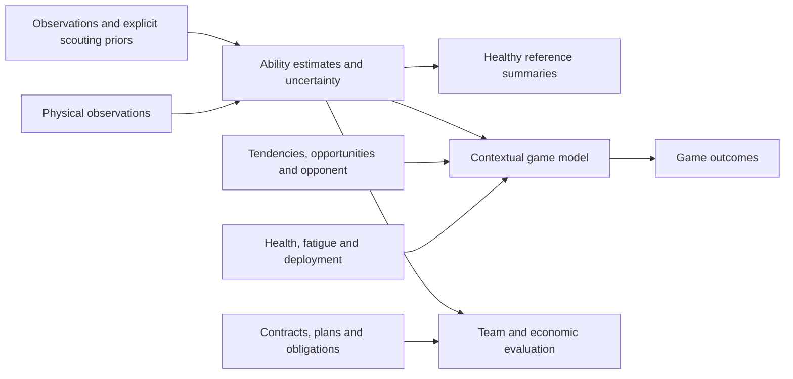

# Player ratings blueprint — November 11, 2026

**For human review: candidate definitions, not approved new ratings.** Recommend **21 core abilities**, two optional shooting-context capabilities, and separate physical/tendency/state/evidence records. This is a target vocabulary, not a requirement to populate 21 precise numbers from today's data. Unknown means uncertain, not bad. The offline role prototype’s missing-input prior35 is an unvalidated diagnostic choice, not the proposed production unknown=weak rule. Current skills are not automatically converted into newly named measurements.

**Current-task checkpoint:** read-only investigation complete; this document is the only authored file. No production/data/simulation/GUI/role/growth integration. Preserve the completed [defensive reconstruction](DEFENSIVE_INPUT_RECONSTRUCTION_2026_11_11.md) and [offline role prototype](DEFENSIVE_ROLE_PROTOTYPE_2026_11_11.md). **Rim-input recalibration remains the first implementation after these definitions are reviewed.** No legacy-save compatibility framework is proposed. Stop at the design decisions below.

## Full proposed rating list

Keys below are **proposed**, not existing API keys. Each means performance at a declared reference difficulty/opportunity, not the number of attempts a coach gives a player.

| # | Proposed ability | Plain-English meaning |
|---|---|---|
| 1 | `rim_finishing` | Convert an available rim opportunity, including functional touch/contact execution; not creating the drive |
| 2 | `short_two_touch` | Execute floaters/short paint shots outside the immediate rim area |
| 3 | `midrange_accuracy` | Execute longer two-point jumpers at reference preparation/contest |
| 4 | `three_point_accuracy` | Execute a balanced, prepared three-point shot at reference distance/contest |
| 5 | `free_throw_accuracy` | Convert an awarded free throw; independent of release speed or foul volume |
| 6 | `rim_access` | Create entry to a useful interior opportunity with the ball against a reference defense |
| 7 | `foul_drawing` | Earn shooting contact/free throws conditional on involvement and attack context |
| 8 | `handle_security` | Retain/control the ball under pressure; not usage or scoring prestige |
| 9 | `passing_decisions` | Recognize/select a useful pass or keep the ball; includes risk judgment |
| 10 | `pass_delivery` | Execute the selected pass with usable placement, timing and velocity |
| 11 | `post_craft` | Create/execute a post advantage through positioning, footwork and counters |
| 12 | `off_ball_movement` | Create receiving/cutting/relocation advantages without the ball |
| 13 | `screen_execution` | Set useful legal angles/timing and recognize slips/re-screens; not simply body size |
| 14 | `offensive_rebounding` | Win/extend a genuine offensive-rebound opportunity |
| 15 | `defensive_rebounding` | Secure a genuine defensive-rebound opportunity in context |
| 16 | `containment` | Prevent/recover from an on-ball perimeter advantage at reference matchup difficulty |
| 17 | `screen_navigation` | Maintain/recover useful defensive position through screening actions |
| 18 | `help_defense` | Recognize, time and execute off-ball coverage/recovery responsibilities |
| 19 | `rim_defense` | Effective interior prevention/contest ability, already including functional physical tools |
| 20 | `disruption` | Execute useful steals/deflections conditional on opportunity, distinct from gambling frequency |
| 21 | `conditioning` | Sustain repeated effort and recover during workload; not health, career minutes or work ethic |

**Optional capabilities, not automatic extra grades:** `pull_up_execution` and `movement_shot_execution`, expressed as context-specific execution modifiers with uncertainty. They do not add universally to shooting/OVR. A reference catch shot is the baseline, not a third catch-and-shoot talent bonus. Keep **release timing** and **distance/range curve** as measured/scouted profile parameters where supported; do not infer fast release from shot volume. Do not add separate short-roll/lob/skip passing skills or a box-out grade by default. Their split tests are below.

**Other player information, deliberately outside that list:**

- Physical observations: height, mass, wingspan/reach; optional independently assessed speed/acceleration, lateral mobility, strength and vertical tools with source/uncertainty. Height is not strength, position is not ability, and absent measurements do not become low grades. Use tools once in the chosen model semantics, not as a second bonus on an already effective skill.
- Tendencies/repertoire: zone and distance selection; catch/pull-up/movement shares; drives/post/roll/cut frequency; passing willingness/target repertoire; screen frequency; rebound-crash versus retreat; gambling/contact risk. Ability answers “how well”; tendency/opportunity answers “how often, when, and against whom.” Defensive foul control initially stays a contextual risk/evidence profile, not an unexplained high-quality rating.
- Transient state: injury availability, fatigue, rust, workload, morale/satisfaction and actual deployment. Keep healthy ability distinct from today's effective contribution.
- Evidence: source, as-of date, units, sample denominator, role/opponent context, coverage, uncertainty and reviewed-prior status. These are not skills.
- Derived summaries: shooting, creation, spacing, OFF, DEF, OVR, fit/portability, playoff robustness, expected steal/block rates and role suitability. Derive once from the underlying package/context; do not award another independent skill bonus for its summary.
- Development: entry abilities, skill-specific capacity/aptitude and uncertain future growth, separate from current skill and personality. Do not change growth in the first recalibration.

**Proposed summary rule:** healthy reference ability should not rise just because minutes/role labels change. Exposure and lineup fit belong in separate contribution/value outputs. Do not use max-role suitability as universal DEF. A single OFF/DEF/OVR remains an optional transparent reference summary, not an asserted probability or equal impact unit across jobs. Do not choose final summary weights before validating underlying inputs.

The intended dependency order is:

Summaries do not feed back as extra independent skills. Shared physical causes can affect multiple abilities, but their same effective contribution must not be added again under another label. Generated outcomes/presentation are not independent observations.

## Actual current model: scope and source map

This inventory covers player skills/ability ratings, profiles and adjacent state/value summaries, not every team/coach grade, box statistic or monetary UI indicator. The findings trace these implementation points, rather than treating `ratings_guide` text as a specification:

- [Player/Trait/Contract schema](../src/nba_gm_data/schema.py), [trait inference/calibration](../src/nba_gm_data/traits.py), [ingestion/overlays](../src/nba_gm_data/ingest.py).
- [Player summaries and save materialization](../src/nba_gm_data/save.py): `_uncached_player_attribute_summary`, `canonical_with_save`, `starting_slot_score`, retention helpers.
- [Runtime features and box/score generation](../src/nba_gm_data/sim.py): `player_feature_vector`, `player_impact_score`, `distribute_player_lines`, `team_shot_diet`, `shooting_line`.
- [Interior offense and evidence profiles](../src/nba_gm_data/offense.py), [shared defense](../src/nba_gm_data/defense.py), [spatial grades](../src/nba_gm_data/spatial.py), [chart projection](../src/nba_gm_data/shot_chart.py).
- [Health/development](../src/nba_gm_data/health.py), [capacity/role blends](../src/nba_gm_data/talent.py), [prospect conversion](../src/nba_gm_data/draft.py), [prospect presentation](../src/nba_gm_data/prospect_cards.py).
- [Trading/strategy](../src/nba_gm_data/transactions.py), [contracts](../src/nba_gm_data/contract_ai.py), [fantasy projection](../src/nba_gm_data/fantasy_draft.py), [extension projection](../src/nba_gm_data/extension_analysis.py), [payloads](../src/nba_gm_data/app_actions.py), and the read-only inspection of `gui/app.js:playerCardRatingGroups`.

`schema.Player` stores identity/team/position; age/birthdate; height/weight/wingspan; projected/prior minutes; offensive/defensive role labels; raw eligibility/missing/fallback metadata; rotation priority; source IDs; external/draft identity; and optional `current_ability`/`potential`. It has **no independent work ethic, coachability, leadership, composure or player-personality skill fields**. Role labels and prior minutes are deployment evidence/priors, not automatically observed talent. `current_ability` is prospect/imported prior information, not interchangeable with runtime `overall`.

`TraitValue` stores `trait_key`, `value`, `confidence`, source kind/IDs/date, notes and components, keyed to a player. The 15 values are usually **inferred/scouted estimates**, not 15 directly measured tests. Initial input percentiles/role bonuses are followed by subjective trait/composite nudges, preservation, manual/rookie/roster corrections and later reviewed overlays. The reconstruction reproduces all 3,455 current defensive values/metadata and documents lost range, ordinal-tie bias, physical overlays and repeated source evidence. A new metadata timestamp/confidence value does not constitute new observations.

### Consumer notation for the following matrix

**S** = raw trait, **D** = deterministic derived rating, **B** = behavior/opportunity proxy, **P** = physical/tool proxy, **X** = transient state, **E** = evidence/uncertainty. Many current traits mix categories; the classification is a diagnosis, not an endorsement.

**V/R** means the actual `sim.player_feature_vector → transactions.build_player_asset_valuations/player_on_court_value/role_scarcity_score → strategy, contract profiles and safeguards` route, plus `save.player_attribute_summary → slot/rotation/retention/cuts`. It does not mean every trait is directly a salary coefficient. Current v2 role-aware impact allows every trait to enter some composite pathway. **G** means the trait is in all-15 `health.DEVELOPMENT_TRAITS`: role/age/staff/health/current level/seeded focus and, where present, career capacity determine monthly deltas. Derived facets/summaries have no independent growth ledger.

## All 15 stored NBA traits: meaning, inference and actual uses

Initial source formulas below precede the overlays; they do not claim every final player's number equals the initial inference. `p` denotes the pipeline's source-cohort percentile; missing inputs can be reweighted/defaulted. Full coefficients/provenance remain in the linked functions and reconstruction artifacts.

| Exact stored key | Intended meaning / current category | Actual source/inference | Direct game consumers, display alias, AI/growth, missing discriminator |
|---|---|---|---|
| `release_speed` | Shot preparation/release quickness; currently S/B mixed | Mean p(3PA/75,3P%,off-screen share,handoff share), movement-role +18 | `release`; part of Shooting/Spacing; spatial shooting, scoring-usage synergy, three-point volume/accuracy **and FT accuracy** through offensive profile. V/R; G. No measured release duration/contest-window sample; FT use is not proof release quickness causes FT talent. |
| `shooting_range` | Long-distance threat; currently accuracy/volume/range mixed | Mean p(3PA/75,3PA rate,3P%), shooting-role +8 | `range`; nonlinear spacing, three volume/accuracy, shot diet, spatial efficiency/gravity, impact and usage. V/R; G. No independent distance/contest curve; attempts are not maximum functional range. |
| `shot_versatility` | Scoring repertoire; currently strong data-coverage/B component | 55×available playtype count/9 + .45×mean playtype share, bounded; counts available types, not demonstrated efficiency | `versatility`; default **runtime shot_creation is this value**, unless ≤5 then handle/rim/range fallback. Also Shooting/Creation, scoring exposure, post/two-point profile, spatial midrange/three efficiency. V/R; G. Missing playtype rows can depress a supposed skill; usage breadth does not establish difficult-shot making. |
| `rim_pressure` | Interior advantage creation; currently access/finish/foul-draw mix | Mean p(FTr,under-6ft efficiency,ball-handler share,transition share,box creation) | `rim_pressure`; nonlinear attack pressure, rim/FT diet, scoring allocation/FTA, finishing/two-point efficiency, post and “athleticism.” V/R; G; **physical-decline group**. Cannot isolate beating a defender, converting the chance, or earning a whistle. |
| `handle_pressure` | Control under defensive pressure; currently creation/load mix | Mean p(box creation,inverse creator TO%,PnR PPP/share,touches) | `handle`; Creation/impact/usage/scoring and post craft; shot-creation fallback. V/R; G. **No direct negative handle term in individual turnover formula**; player TOs use minutes/usage plus noise, with team-pressure effects elsewhere. Source role efficiency is not a clean ball-security test. |
| `passing_reads` | Passing recognition/organization; S with production proxies | Passer rating, assists/75, box creation percentiles + raw BBallIQ | `passing`; runtime passing is mean(reads,scheme); offense-v9 feeder passing uses reads directly. Assists/pressure release/scoring connectivity/role fit. V/R; G, protected from the extra older non-IQ decline rule. No clean choice-versus-placement, teammate-shot, or delivery-context distinction. |
| `foot_speed_lateral_agility` | Movement/containment tool; currently P/S proxy | .24 deflections + .24 steals + .22 versatility + .30 DPM percentiles, role +4/+10 | `lateral_agility`; activity/DEF, spatial perimeter defense; also assisted finishing, Athletics/impact. V/R; G; physical-decline group. No timed feet/acceleration or independent containment observation; almost identical evidence to navigation. |
| `stamina_cardio` | Repeated workload capacity; currently opportunity/B proxy | Projected/prior minute percentiles plus movement-offense bonus; old arithmetic repaired where reconcilable; some workload priors/manuals | `stamina`; game pace, fatigue gain, injury-risk/durability construction, offense screening, Athletics/REB/impact. V/R; G; physical-decline group. Minutes/health/coach use do not independently measure conditioning; not a chaser skill or work ethic measure. |
| `defensive_effort` | Engagement/disruption; currently correlated event proxy | Mean p(deflections,steals,DPM), role +12 | `def_effort`; .42 of activity, spatial contests/help/perimeter, steals/disruption and DEF. V/R; G; physical-decline group. No independent sustained engagement/containment observation; high-event role can masquerade as effort. |
| `scheme_iq` | Defensive recognition/coverage; currently general-IQ/passing mix | Mean(raw BBallIQ,p(passer rating),p(DPM)), role +8; role helper checks offense and defense labels | `scheme_iq`; spatial help/contests, runtime passing, screening, derived IQ/role-aware impact. **Not a term in current scalar DEF activity/rim blend.** V/R; G, older-IQ exception. Passing intelligence is not independently verified off-ball help execution. |
| `rim_deterrence` | Effective interior prevention, **already containing size** | .55 block + .24 height + .15 DPM + .06 generic DARKO percentiles, rim-role +6/+16, then bounds/overlays | `rim_deterrence`; monotone `rim_response` drives interior suppression/avoidance, blocks, rebound contribution, DEF, anchor/scarcity and spatial defense. V/R; G. Card alias shows bounded **raw** grade, not response. No new height bonus justified; blocks lack avoidance, opportunity, timing and contest-quality separation. |
| `screen_navigation` | Screen attachment/recovery; currently correlated event proxy | .24 deflections + .24 steals + .20 versatility + .32 DPM, eligible role +9 | `screen_nav`; .22 activity, spatial perimeter coverage, steals/DEF and impact. V/R; G. No independent screen-action outcomes/workload; source overlap with lateral ~.981. |
| `offensive_rebounding` | Offensive board/second-chance ability; S/B mixture | Mean p(OREB/75,OREB%,putback share), rollman-role +8 | `oreb`, plus v9 `offensive_rebounding`; nonlinear possession extension/pace, scoring/valuation interior contribution, **most of total REB display and much of all rebound generation**. V/R; G. Crash opportunity/position differs from winning ability; no separate DREB/box-out trait exists. |
| `portability` | Fit without monopolizing touches; current broad composite stored as S | Mean p(existing Portability,3PA rate,DPM), friendly-role +10 | `portability`; impact, IQ/role blend, spatial corner frequency/gravity, on-court value .06 and price/fit tiers. V/R; G; **treated as physical for extra aging/health drag**, despite broad meaning. Not an independent magic adaptation measurement. |
| `playoff_translation` | Robustness under targeted defenses; D stored/evolving like S | Initial mean of inferred handle/range/rim/effort/scheme plus DARKO/LEBRON; confidence initially .38, later layers can change | `playoff`; **ordinary-game impact .18 before role blend**, star-power .15, IQ and price/playoff value. Not gated to playoffs. V/R; G independently. Initial composite is not automatically recomputed after every later trait change; sparse contextual evidence, broad double counting. |

All source values are currently consumed as point estimates, generally defaulting missing traits to50; display defaults can become1. Trait confidence mostly informs construction/scouting, **not a universal runtime multiplier**. Constant feature confidence .62 and profile confidence .58/.82 should not be read as validated accuracy probabilities.

## Every standard current display rating and formula

Let `avg` be an arithmetic mean; E=effort, L=lateral, N=navigation, Q=scheme, R=raw rim, F=passing, U=rim pressure, H=handle, V=versatility, G=range, J=release, C=stamina, P=portability, T=playoff, O=OREB. `D(x)=round(clamp(x,1,99),1)`. Raw traits may reach100; the common current display is direct bounded model grades, **not percentiles, shooting percentages or equal impact units**.

The 15 direct aliases are exactly: `release=J`, `range=G`, `versatility=V`, `handle=H`, `rim_pressure=U`, `passing=F`, `stamina=C`, `def_effort=E`, `screen_nav=N`, `rim_deterrence=R`, `oreb=O`, `lateral_agility=L`, `scheme_iq=Q`, `portability=P`, `playoff=T`, each through D. The matrix above gives each one's downstream consumers; the alias itself adds no ability.

| Exact derived key | Current formula before D / definition | Actual consumers and semantic limit |
|---|---|---|
| `shooting` | S=avg(G,V,J) | Card/Finder; OVR/role impact/rotation/AI. Not distance-specific accuracy. |
| `spacing` | Card: avg(G,J,V), numerically identical to S | Runtime spacing instead uses nonlinear G, with v9 scaling by clamp(three_per36/5,0,1); spatial gravity uses still another blend. Same label has different context formulas. |
| `creation` | K=avg(H,F,U,V) | Card, OVR/slot/retention; runtime `shot_creation` normally V alone. High passing can increase displayed Creation without equivalent shot-making. |
| `defense` | A=.42E+.36L+.22N; DEF=.60A+.40 `rim_response(R)` | Card, role-aware impact, rotation/AI; game also uses separate team/spatial channels. Scheme remains outside this scalar. `rim_response` is documented in defense.py: old low/mid response through 80, monotone shoulder to99 at raw100. |
| `athleticism` | ATh=avg(L,C,U) | Card/OVR/role-aware impact and some strategic needs. Not observed vertical leap/strength/linear speed. |
| `iq` | I=avg(Q,F,P,T) | Card “Basketball IQ,” OVR and role-aware impact. No additional general intelligence or personality observation. |
| `rebounding` | RB=.66O+.18R+.16C | Card/OVR/role impact/slot scores. No distinct defensive rebounding skill; displayed value is not the game's exact rebound-rate formula. |
| `steal` | avg(E,N,L,Q) | Display/scouting aliases. Actual steals are minutes×activity/1850 + noise, then team-total normalization; no direct read of this display blend. |
| `block` | avg(R,L,E) | Display/scouting aliases. Actual blocks use effective rim/2200 plus an elite-rim term/noise and normalization; no direct read of displayed Block. |
| `overall` | OVR0=.22S+.25K+.22DEF+.13ATh+.12I+min(6,minutes/7). Current v2 averages this with `.94 role_skill_value + same minutes bonus` | Role skill is .80 weighted mean/.94 + .20 top-two relevant composites; C/PF/G/wing weights differ. OVR feeds lineup/retention/value comparisons. A minutes/position change can change OVR without changing intrinsic tools. OFF is not substituted into this formula. |
| `post_creation` | v9 post facet below | Direct modeled scorer/lineup/valuation/AI fit; not separately stored or developed. |
| `assisted_finishing` | v9 finishing facet below | Scoring multiplier depends on teammate feeder passing; distinct from solo creation but currently inferred from mixed tools. |
| `screening` | v9 screening facet below | Team contribution, scoring/valuation adjustment and interior OFF; no measured screen-assist input. |
| `offensive_rebounding` | v9 alias of raw O, rounded to1 decimal | Same source as `oreb`; adding both would double count. |
| `offense` | v9 role-dependent mixture below | Card/Finder/offense summaries and some economic interior adjustments; not equal to raw OVR or the runtime team's points formula. |

That is **30 current standard attributes** with v9 enabled:15 aliases,10 fixed derived summaries,5 offense-profile outputs. Additional CLI `derived_trait_attributes` adds `disruption=.40E+.25N+.25DEF+.10P`, `rim_protection=R`, supplies legacy OFF if absent, and **overwrites spacing** with `.45S+.35G+.20J`. These are display/league-table derivatives, not new stored traits. They must not be mistaken for different hidden abilities.

Current card groups “Mental and Physical”/“Mind, Body & Coach” contain Stamina, Basketball IQ, Scheme IQ, Portability and Playoff translation (Athleticism/Lateral are also grouped there on the older branch). **No Work Ethic or Coachability row exists in the inspected `playerCardRatingGroups`.** Group names do not create independent behavior. Quartile colors/league means are presentation comparisons; “elite” color can mean upper quartile, not a source-validated elite capability.

### Exact v9 facet/OFF construction and evidence branches

This is current behavior, not proposed new weights. Let height h default78, weight w default215; `size=clamp(40+4(h−76)+.12(w−210),15,95)`; `big=clamp((h−77)/6,0,1)×(1 for primary C/PF else .4)`.

- Initial post p=(.50U+.30V+.20H)×(.45+.55big); finishing a=.65U+.20size+.15L; screening z=.45size+.35Q+.20C. Default post share=big×(.025+.004max(0,p−45)); roll share=big×(.10+.004max(0,a−45)). This uses physical opportunity **and** mixed skill proxies, not independently observed post/screen talent.
- Identity-checked career priors use recent eligible seasons and source URLs. Post/roll PPP/share priors have weight u≤.35 because possession counts are absent; frequencies mix with weight min(.65,2u). Post target=clamp(50+85(PPP−1),20,90)+.50ΔU+.30ΔV+.20ΔH; roll target=clamp(50+65(PPP−1.05),20,90)+.65ΔU+.15ΔL. Mix facets with u. Δ means current trait minus frozen evidence-anchor trait.
- Two-point base=clamp(.43+.0017U+.001max(0,size−55),.40,.70). Observed two-point prior adds .0018ΔU+.0005ΔV and mixes with its attempt-based weight; finishing additionally moves toward clamp(50+160(observed−.52),20,90) with weight .35×two_weight.
- Three volume fallback=clamp(.55×(max(0,G−28)/10)^1.7,0,12). Career volume mixes by volume_weight with prior+.14ΔG+.025ΔJ; a demonstrated near-nonshooter has a small-change cap. Three accuracy is prior or `.28+.002max(0,G−35)`, plus .0015ΔG+.0005ΔJ, bounded .20–.48. FT accuracy is prior or `.64+.0018J`, plus .001ΔJ, bounded .45–.95. Career accuracy priors use pseudo-attempt shrinkage; rate/accuracy uncertainty differ. Final `three_per36` bounds0–14, two_pct .38–.75.
- Legacy offense L0=.35S+.32K+.18F+.15U. `post_weight=.10+min(.20,.7post_share)`; interior=p×post_weight+(1−post_weight)×(.45a+.25z+.30O). `interior_weight=.32big×clamp(1−three_per36/10,0,1)`; OFF=(1−interior_weight)L0+interior_weight×interior. Facets clamp1–99 and card round1 decimal; profile numeric fields round4 decimals.

`post_share`, `roll_share`, `three_per36`, `two_pct`, `three_pct`, `ft_pct` and `offensive_passing=F` are additional **profile parameters**, not extra intrinsic ratings. Team/game consumers aggregate them with context. `support_passing` uses other players' minutes-weighted F; `finishing_multiplier`, `team_contribution` and `valuation_adjustment` make interior roles matter. Do not copy all these existing coefficients into the candidate schema just because they run today.

## Spatial, state, economic and development records

### Court profiles: grades, tendencies, percentages and rendering are distinct

`spatial.player_spatial_profile` has 12 named zones: restricted area; paint non-RA; short-mid L/R; long-mid L/C/R; corner-three L/R; above-break L/C/R. Every zone returns offense `frequency`, `efficiency`, `gravity`, `intensity` and defense `frequency_influence`, `contest`, `suppression`, `intensity`.

Current semantic formulas use shooting `.45G+.35V+.20J`, creation `.48H+.37V+.15F`, role/minute-derived usage, traits, physical offense geometry, stable ID texture and optional official frequency priors. Frequency weights vary by zone, normalize to1, and v9 forces a three share from three_per36/16 (bounded .72). Observed frequencies are opportunities/tendencies, not proof of accuracy. Offensive efficiency is 31+.55U+height term at rim in the older branch; v9 uses30+.40post+.18finish for non-RA paint and35+.50finish+height term for RA; midrange25+.47V+.17creation; threes20+.66shooting+.08V, plus stable texture. Gravity is a shooting/creation/pressure/usage/portability blend by zone. These are **grade formulas**, not actual FG probabilities.

Shared defense uses effective r=`rim_response(R)`: rim suppression22+.58r+.12Q, contest20+.55r+.14E; mid suppression24+.30Q+.18L+.14E, contest22+.27Q+.23L+.14E; perimeter suppression20+.30N+.23L+.15E+.08Q, contest18+.32N+.25L+.15E. Suppression also receives small stable texture. No extra defensive height bonus is added. `frequency_influence=50−.34(suppression−50)`; defensive intensity=.62suppression+.38contest. Offensive intensity=.46efficiency+.36gravity+.18min(99,700frequency), with bounds. `creation_volume=clamp(.52usage+.28creation+.20mean(offense gravity),10,99)` and `defensive_activity=clamp(.35E+.20Q+.15L+.15N+.15R,10,99)` are separate deterministic rollups. Team presentation expands each by `clamp(20+2.5(value−40),10,99)` without changing semantic zone grades.

For completeness, the spatial creation variable is `.48H+.37V+.15F`, not card Creation; usage is `clamp(35+1.1role_minutes+.22(creation−50),20,92)`. Initial frequency weights are RA `14+.46U+.8max(0,h−78)−.07shooting`; paint `9+.19U+.08O+.45max(0,h−80)`; short-mid `7+.12V+.05creation+side`; long-mid `5+.11V+.07creation−.025shooting+side`; corner `4+.15shooting+.07P−.025max(0,creation−72)+side`; above-break `5+.18shooting+.075creation+.045max(0,usage−62)+side`. Three-zone weights multiply by `clamp((shooting−25)/65,.12,1.16)`; C above-break weights have an additional low-shooting penalty. Weights floor at.5, optional observed frequencies mix65%, then v9 three-share adjustment/normalization applies. `side` is stable ID texture, not a sourced handedness observation.

Gravity is rim `24+.58U+.18creation+.12usage`; mid `25+.35V+.26creation+.08usage`; three `18+.58shooting+.14creation+.12P`, each plus.35 stable jitter. Bounds/rounding apply. These formulas expose exactly where a renamed source field would have multiple unintended effects.

Simulation uses these through flattened spatial profiles, lineup weighting and `spatial_matchup_adjustment`; trade/signing/draft fit also consumes profiles. **The displayed fifteen-region shot chart is a separate projection**: neighbors in a trait/height vector, matched-player observed shape, league FG baselines and grade deltas, conditioned on saved shot mix. `fg_pct`, `delta_pp`, `suppression_delta_pp`, density and visual pockets are projected statistics/rendering, not new skills or independent corroborating data. Its five-neighbor weights use exp(−normalized distance/.65); a matched-player observed shape gets weight clamp(.88−.30shift,.35,.88). Region FG delta is observed neighbor delta+.35(current efficiency−neighbor reference grade), bounded±22 percentage points; projected FG%=league FG%+delta, bounded 0–100. Suppression delta=.35(current suppression−league defense grade); defensive density uses contest/league-contest ratios and renormalizes. Stable texture must not be mistaken for measured left/right skill. Prospect spatial profiles also use a simplified archetype/ability prior, not exactly the signed-rookie conversion: another eventual alignment gate.

### Health and morale

`PlayerHealthProfile` has durability, injury-prone flag, risk tags/history and evidence; `PlayerHealthState` has fatigue, rust, current injury/availability/return date/games missed. Generic durability includes age, workload, stamina, weight/position and out-for-season priors; reviewed medical overrides exist. Generated medical history uses a separate seeded fictional model. Injury risk/fatigue are operational; durability is not a claim of current offensive/defensive skill.

`health_adjusted_player_features` subtracts fatigue/rust penalties from selected features (including impact, usage, creation, pressure, activity, effective rim, passing, stamina and interior facets), and raises weak-link exposure; absence constrains the active pool/minutes. It does not rewrite all healthy raw skills or every shot-percentage field. Monthly health drag can affect later development. A card's healthy grade and an injured player's present game contribution are therefore different views.

Player morale keys are `overall`, `role_satisfaction`, `team_confidence`, `contract_satisfaction`; team morale includes overall/chemistry/confidence. Startup uses team context, minutes, age and deterministic variation; game/press results update it. **No direct use of player morale was found in the inspected simulation-feature, monthly development or contract scoring paths.** It is maintained/reportable/narrative state, not evidence of work ethic or a hidden skill multiplier. Staff personality/communication/adaptability are separate staff data; do not project them onto players.

### Actual development and mental behavior

All 15 stored traits grow/decline through `health.monthly_trait_delta`; no independent growth applies to Shooting/DEF/facets. Inputs include age/maturation, exposure/role priority, staff multipliers/focus, current level, health drag, save seed, potential/ability, realization/timing and optional per-trait `career_capacity={version,entry_value,ability,potential,aptitude}`. Aptitude/capacity and seeded realization actually affect ceilings and growth; they are **modeled latent development variables, not observed human coachability**. Focus weights prefer different traits by position/archetype/age/staff. `PHYSICAL_TRAITS` currently includes lateral, stamina, rim pressure, defensive effort **and portability**; an extra older-age decline rule exempts scheme/passing/portability. This is a semantic inconsistency to review, not permission to retune growth here.

There is no independently researched NBA work-ethic/coachability mechanism. Adding those labels would require a real defined effect, evidence policy and fictional-player generation policy. Do not infer real character from scoring, sparse minutes, age or team success. Keep current development unchanged until new ability definitions and scale compatibility are accepted.

### Contracts and player-value numbers are not basketball skills

Contracts store owner/status, seasons/salary, guarantees/options and eligibility metadata/confidence; save overlays hold new agreements and dead/waived obligations. They influence value, legality and retention, not shooting ability. `PlayerContractPreference.priorities` contains money/role/winning/security/loyalty/market/patience/fit, initially from role/age/salary plus stable variation. These have independent negotiation behavior but are explicitly **inferred agency priors**, not measured basketball personality. Morale's contract_satisfaction is not the same record.

| Visible non-skill quantity | Actual construction/use |
|---|---|
| `health_risk` | `transactions.player_health_risk`: durability shortfall, prone/history/tags, current absence/rust; bounded 0–34 in the full model, rounded 1 decimal on card; a fallback valuation can use45. Not a medical diagnosis or injury probability. |
| `upside_remaining` | NBA card: clip(valuation.development_upside/22×5,0,5), rounded. Prospect card after unlock: clip((projected potential−now)/5,0,5). Different meanings; neither is five guaranteed OVR points. |
| `trade_value` / `player_value` | Asset valuation combines on-court features, age, developmental value, surplus, scarcity, playoff signal and risk; market target additionally shapes stars, role/minutes, rookie floors and saved production. Not OVR; protected consideration/premium checks remain separate. |
| `on_court_value` | .42impact+.09usage+.08shot_creation+.08spacing+.06pressure+.07passing+.07activity+.07effective_rim+.06portability−weak-link penalty, plus bounded interior valuation adjustment. Reuses broad derived quality; candidate summaries must avoid further double counting. |
| Salary/ask/bid/fit | Contract role tiers/comps, present contract anchor, value/scarcity, age, health, team need/finances, inferred priorities and fresh approval. Salary unknown/unresolved is not low talent; saved asks need appropriate rebuilding after ability changes. |
| Fantasy `likely_growth`, `high_end_growth`, `ceiling_overall` | Three-year heuristic: age runway×headroom×upside signal×role exposure, capped5 high-end; likely is a fraction. Source is `fantasy_growth_outlook`, not a simulated guaranteed career. Fantasy AI also uses engine quality/growth/ceiling, so its explanatory profile is not wholly inert. |
| Extension `overall/low/high` curves | Seven private scenarios calling the existing monthly trait model with fixed-role/staff/health scenarios and separate preview seeds; median/min/max, not calibrated confidence intervals or save-future RNG. |
| Scouting `now/potential/floor/ceiling`, confidence/coverage | Team-specific estimates/projection bands, reveal rules and modeled upside; source coverage is not intrinsic skill. See prospect mapping below. |

Healthy reference retention uses current OVR/minutes/age, bounded upside, draft experience, contract/waiver cost and core plans. AI slot assignment also consumes creation/passing/spacing/defense/rebounding/rim and physical/position restrictions. Current core/premium/pick-investment safeguards use full fresh contexts, not a proposed role label. A skill/schema change must audit these pipelines without weakening them or replaying stale search approval.

## Imported/generated/prospect meanings

The 12 stored prospect traits are `shot_creation`, `shooting`, `rim_pressure`, `passing`, `defense`, `rim_protection`, `rebounding`, `feel`, `athleticism`, `size`, `motor`, `nba_readiness`. They are **not aliases for all 15 NBA inputs**.

For the research-stat inference branch, let p/a/r/s/b be points/assists/rebounds/steals/blocks per36; u=usage, t=true-shooting fraction, B=BPM, D=DBPM, h=height. These are source-model priors, not measurements of the named skill. The function adds archetype biases and clamps 25–95; generated v2 diversity can further alter strengths/weaknesses in its separate seeded generation lane. Raw prospect panels use team scout estimates/bands; the NBA-style card uses the conversion, not a direct alias.

| Prospect key | Plain meaning; current initial inference | NBA conversion / information use |
|---|---|---|
| `shot_creation` | Scoring creation prior:50+.9p+.35u−26 | Versatility/handle/attack conversions; not a separate observed dribble test |
| `shooting` | Broad shooting prior:50+85t−45 | Release/range, some versatility/portability; TS is not pure jump-shot accuracy |
| `rim_pressure` | Attack prior:50+.45p+.20u−13 | Combines with athleticism/size for NBA pressure |
| `passing` | Passing prior:50+5.2a−6 | Reads, handle, scheme; assists confound decisions and execution |
| `defense` | Broad defense prior:50+5 s+1.4D | Effort/lateral/navigation/rim/scheme/portability; one source reused across jobs |
| `rim_protection` | Interior prior:50+9b | Dominant NBA rim input, with size/archetype; no independent avoidance observation |
| `rebounding` | Board prior:50+2.4r−5 | Becomes chiefly NBA OREB; no independent O/D distinction |
| `feel` | General recognition prior:50+1.6B | Reads/scheme/navigation/portability/playoff; not researched coachability |
| `athleticism` | 38+.22rim_pressure+.10defense+.08size+archetype athletic bias+.18max(0,u−22) | Movement/pressure/effort/handle/conditioning; not independent speed/jump measurement |
| `size` | Physical prior:50+1.8max(0,h−76), plus archetype | Physical-style conversions; not measured strength |
| `motor` | Activity prior:50+.7r+2.5 s, plus archetype | Effort/conditioning/OREB; not observed training habits |
| `nba_readiness` | Readiness prior:50+1.1B+22t−12 | Skill/readiness/conditioning conversion; not morale |

All 12 feed scout reports, board/fit evaluation and/or current/potential/capacity-related conversion; they are not 12 independent monthly NBA growth channels. `draft_board_report`/team scouting distinguish estimated readiness/ceiling from hidden true generated traits. Exact reveal dependencies are in `PROSPECT_CARD_RATING_DEPENDENCIES`; e.g. block requires rim_protection, while scheme requires feel/defense/readiness/passing. Unknown/unrevealed fields are locked, not a zero-quality judgment.

`nba_trait_values_from_prospect` performs weighted blends, archetype bonuses, current-ability/target-mean anchoring and readiness adjustments. Current v2 navigation is .62defense+.18athleticism+.20feel; rim is .84rim_protection+.12size+.04defense before archetype/mean/readiness adjustments. `rookie_trait_records` bounds/rounds and can attach per-skill capacity; this target definition must eventually match imports, not just produce a similar mean.

`prospect_card_ratings` reveals fields only when required scout traits are unlocked. `prospect_rating_projection` converts scout-estimated or fully known prospect traits through rookie conversion and the standard NBA summary; after signing it can use actual signed-player ratings. Coverage below 100 can substitute estimated current/potential and trait midpoints; floor/ceiling use source fields or defaults. These are information-state estimates, not additional abilities. **The card's `college_production` can generate illustrative season/log output from identity-seeded random draws, not those underlying skill values. It must never be recycled as independent evidence validating ratings.**

For the candidate schema, define one common ability vocabulary first. Imported players get evidence-backed estimates/scouting priors; generated players get hidden synthetic truths plus separate scout uncertainty. The same amount of a skill must have the same reference game consequence in either source lane. Do not feed generated role assignments or synthetic box scores back as “observed” truth. Add new traits to development capacity only after entry-scale and meaning tests; do not refit growth to compensate for an import error.

## Split/merge decisions: concrete contrasts and evidence gates

These are **controlled contrasting player profiles**, not newly assigned ratings for real people. Each pair holds unrelated tools/opportunity fixed. No split is accepted just because its name sounds realistic. Where independent observations are unavailable, a dated explicitly low-confidence scouting prior is the route; never copy the same source statistic into several new “measurements.”

| Candidate decision / action | Concrete pair that requires distinction | Evidence route or explicit prior | Different intended consequence / limit |
|---|---|---|---|
| Split shooting by useful distance: rim/short-two/midrange/three/FT | A: strong floater/paint touch, weak long jumper; B: same rim chances but reliable long-two/three, weak short touch | Zone attempts/makes with distance, assisted/contest/context and shrinkage; film prior when sparse | Only the relevant opportunity's conversion changes. FT cannot improve because release is quicker. Avoid per-side raw skills inferred from texture. |
| Separate base accuracy from pull-up/movement execution, **conditional profiles** | A: reliable prepared catch shooter who struggles live-dribble; B: equal catch accuracy but maintains balance on pull-ups. Second pair: movement-route shooter vs stationary specialist with same open accuracy | Catch/pull-up/movement attempts, contest and shot difficulty; film preparation/footwork priors, not volume alone | Conditional accuracy penalties/advantage windows. Do not add all context scores to every shot or use low observed frequency as inability. |
| Rename range/release to distance/preparation profiles; defer exact release grade | A/B equal line-distance accuracy but A retains it deep; C/D equal accuracy but only C gets the shot away before the same closeout | Distance curves and measured/video release windows; explicit scouting bands | Deep attempts/defender distance and blocked/contested release window, not a global scoring or FT bonus. Unknown deep sample stays uncertain. |
| Split access, finishing and foul drawing | A: driver who beats the first line but misses the finish; B: dependent receiver who converts the same available chance. C: equally involved attacker with stronger contact-drawing craft | Drives/paint entries, assisted status, contest/contact/FTA per relevant action; film prior for contact skill | Opportunity creation, conversion and foul/FT generation differ. Do not let FTr simultaneously prove speed, finishing and accuracy. |
| Retain ball control as `handle_security`, separate from scoring creation | A: secure organizer who cannot separate for shots; B: dangerous shot creator who loses control under the same pressure | Pressure turnovers by action/touches, ball control/recovery film; separate usage/difficulty | Loss hazard changes without automatically raising scoring volume. Current individual TO path needs a later real consumer, not just a new card key. |
| Split pass choice and execution; **do not automatically split interior/perimeter delivery** | A sees the open target but cannot place the pass; B delivers accurately but picks the wrong target. Range test: short-roll/lob specialist vs long-skip specialist with comparable general passing | Annotated decisions/options and delivery accuracy under pressure, start/end locations, receiver/shot context; explicit skill-specific priors | Missed opportunity vs inaccurate chosen pass. Add delivery-context modifiers only if independent evidence and different outcomes survive controlled tests. AST alone supports neither precision split. |
| Derive less of post craft from driving/handling; proposed independent prior | A: same size, strong footwork/counters, weak perimeter access; B: same finishing, strong drive game, weak back-to-basket craft | Post possessions, opponent size/help, shot/pass outcomes; footwork/counter film prior | Advantage from post situations, not all drives or global handle. Zero post use is not zero post ability. |
| Separate off-ball movement, movement shooting and screening | A: excellent cutter/relocator with poor jump shooting; B: good stationary shot-maker who rarely opens a receiving window. Screener pair: strong untimed body vs lighter precise legal-angle screener | Routes/timing/open windows; screen opportunities/quality, slips and film; screen assists adjusted for teammate making | Teammate advantage and receiving quality, not one's own universal shooting. Strength is a shared cause, not a second independent screen observation. |
| Split OREB and DREB; **hold independent box-out rating** | A: effective offensive crasher, weak defensive position/secure; B: same total boards but secure defensive possessions. Box-out test: teammate-enabling blocker vs uncontested stat collector | O/D chances, contested/uncontested context, crash/retreat, box-out film/tracking where acquired | Own extra possessions vs ending opponent second chances; box-out can benefit a teammate. A new DREB field must reach joint miss/rebound logic, not just inflate all box totals. |
| Separate containment and navigation; stop inventing both from steals | A wins the same isolation but gets erased by screens; B tracks movement/screens but loses a larger direct matchup | Same-identity matchup/action film and guarded possessions/difficulty; separate reviewed priors | Isolation/drive access vs screen-created advantages. Mobility can help both but one event composite cannot certify both. |
| Separate help execution from rim defense | A rotates early/tags/releases correctly but cannot anchor deep paint; B contests deep attempts well but misses perimeter rotations | Coverage decision/recovery film; rim attempts/quality/avoidance/volume and uncertainty | Arriving at the problem vs defending an available interior attempt. Keep effective-rim size semantics; do not add reach twice. |
| Separate disruption skill, gambling tendency and foul risk | A creates useful hand events but over-gambles; B contains without chasing steals. C contests effectively with excess contact; D maintains the same contest with fewer fouls | Event opportunities + failed gambles, fouls by action/assignment, film discipline prior | Steal/loss events, exposed lanes and foul/FT cost are separate. Foul control can be a real execution skill, not just voluntary aggression. Defer its standalone grade until independently supported and consumed: current minute-based PF generation has no such consumer. |
| Separate physical observations from broad Athleticism | A/B have equal height/mass/reach but one is fast straight-line/weak laterally and the other the reverse; C/D equal mass but different functional strength | Measured drills where relevant, context-specific film or an explicit physical scouting prior; not recycled steal/impact ranks | Feasibility/access/contact constraints, not another universal skill bonus. Do not invent all speed/vertical/strength grades from body size or double-count effective rim skill. |
| Separate conditioning, availability and work habits | A sustains repeated stints but has recurrent medical absences; B stays healthy but cannot sustain the same effort. C/D same body/current skill but genuinely different learning response | Within-stint effort/recovery; separate medical history; learning/feedback evidence or explicit fictional latent model | Fatigue/recovery, absence risk and future development are different. Do not infer real player's diligence from minutes or health; no new work-ethic/coachability implementation now. |
| Merge portability/playoff translation into derived fit/robustness outputs | A scales beside a creator but struggles targeted defense; B can self-create but duplicates teammate usage | Test the same skills across stated lineups/opponents/pressure situations; label uncertain scenarios | Different context outcomes without extra universal skill points. Recompute summaries, do not independently grow them and add them back to impact/price repeatedly. |

Some latent causes legitimately overlap: mobility helps access/containment; size/strength help finishing/screening/rebounding; anticipation helps passing/help. That does not require independent numerical ratings for every cause. Document whether a grade includes its functional physical package or is size-neutral technique before adding tool effects. Keep size/position feasibility and actual duty exposure separate from skill quality; unusual builds must be possible. Role selection cannot grant skill points.

## Engine implications that definitions must acknowledge

The current simulator is largely **team-score-first**, then distributes points and synthesizes shooting/secondary stats. `offense.shooting_line` preserves assigned points while sampling a 3PT/FT mix and recovering two-point makes/attempts. A new shooting accuracy field might change a box mix without changing team points unless its team-efficiency consumer is also correct. Assists/steals/blocks/rebounds are subsequently normalized to bounded team totals. Better individual skill does not automatically create a correctly conserved opponent outcome.

Current scoring/assist code also contains named/profile-specific paths (including Luka's assist adjustment and the Curry off-ball-veteran profile). These are actual consumers beyond a generic rating formula, not independent evidence for underlying skills. A future general schema must test their contribution separately; this document neither removes them nor tunes new raw grades to cancel them.

Current total rebound generation mainly uses OREB/effective rim; team offensive boards are inferred from misses and an OREB rate, with DREB as a residual. Personal fouls are minute-weighted Poisson draws on a separate RNG and do not alter rotations. A proper new DREB/foul-drawing/control consequence therefore needs a bounded later engine change. This is **not** authorization for a possession/coaching rewrite; first agree what the inputs mean, then prove one consequence at a time. Preserve RNG/event ordering when a change should be exact; document intentional numerical changes when it cannot be.

## Staged implementation and verification — no execution in this task

1. **Definitions and evidence contract.** Review the candidate list and hard choices below. Every field gets meaning, reference conditions, units, known/prior/unknown status, sample/as-of metadata and a declared consumer. Freeze source reference anchors; no roster-max scaling or annual/star quotas. Do not promise all imports have independent measurements.
2. **First implementation stays rim-input reconstruction/calibration.** Keep roles offline. Start from the completed all-player trace: distinguish lost numeric range from block/height/role/impact reuse, resolve aligned sample denominators and reviewed holds, preserve explicit overrides and fix stale composite-nudge semantics. Validate small samples/outliers and fixed cross-role anchors. This gate is pending, not superseded by the blueprint.
3. **One accepted input family at a time.** Shooting/pressure/control/passing/rebounding changes each require the contrasting fixtures above and source/scouting priors. Do not batch-fill new names using the old percentile vectors. Compare unchanged inputs/current engine, accepted inputs/current engine, then any proposed engine consumer; keep projections separate from observation.
4. **Minimal consumer integration.** For each accepted field, test a single intended consequence and non-effects: pull-up change leaves FT/open catch unchanged; delivery differs from pass choice; DREB changes second-chance opportunities without fabricating misses; rim improves interior defense without guard navigation; workload/label changes do not manufacture skill. Keep shared physical causes once. No coach changes until player and engine meanings work.
5. **Generated/imported parity before growth retuning.** Convert controlled same-skill imported and generated profiles through identical summaries/game consumers; test source-unavailable priors and team scouting locks. Preserve entry ability/capacity relationships and expose uncertainty. Do not calibrate career growth against synthetic card stats or patch growth to hide input bias. Old saves are disposable; use a clean new baseline, not migration branches.
6. **Economic/safety and bounded real-action gate.** Rebuild valuations, plans and contract market profiles; inspect asks/bids/extensions, healthy neutral retention/cuts, core/premium returns and pick-investment/fresh settlement decisions. Any schema signature must join existing snapshot/cache invalidation; no new broad state framework. Test immutability, sequential settlement and fresh revisions. Use disposable careers, bounded multi-seed matchups only for shipped ability changes, daily/bulk/midpoint reload and ordered events/explanations. Sequential short timing/memory samples protect prior optimizations. No full season or automatic threshold/growth/rotation compensation.

## Decisions for the user

1. **Scope:** accept the 21-core vocabulary as the target, or prefer a smaller model that explicitly combines short/mid touch and keeps some specialized skills as uncertain profiles? Recommendation: accept the vocabulary, populate in stages; do not manufacture complete precise grids.
2. **Shooting context:** retain two optional pull-up/movement capabilities plus range/release profiles, or combine into a single shot-difficulty model? Recommendation: keep contexts distinct where supported; defer exact unsupported grades and avoid universal bonuses.
3. **Passing detail:** one delivery ability plus decision skill, or separate interior/lob/skip abilities now? Recommendation: two core skills, hold the extra delivery splits until their independent evidence/consequences justify them.
4. **Summary meaning:** healthy reference OFF/DEF/OVR plus contextual fit/contribution, or role/minutes-dependent headline talent? Recommendation: healthy reference summary with explicit context separate; no minutes bonus or max-role grade as intrinsic talent.
5. **Mental/personality:** descriptive evidence and existing latent development only, or future independent work-ethic/coachability mechanics? Recommendation: no new real-player character grades now; retain uncertainty, and define any fictional behavior separately before implementation.
6. **Rebounding/fouls fidelity:** approve separate ability definitions now but defer conserved opportunity/foul consumers, or keep the present coarse totals? Recommendation: agree on the distinct definitions now; implement only when their intended effects can be verified, without expanding into coaches.

**Stop here for definition review.** No simulations/tests/ratings changes or preview refresh were necessary for this documentation-only deliverable. The current production preview remains 8798, with both reconstruction and roles offline. Rim recalibration is the next implementation after the chosen definitions/anchors pass review.

Read-only verification: static key coverage checks confirm all 15 stored NBA traits, all 25 fixed summary keys, the 5 offense-profile outputs and CLI aliases are documented; the proposed core list has 21 unique keys and local source links resolve. All 85 source/data/experiment files checked against retained implementation manifests remain unchanged. No functional test, simulation, market action or development preview ran; this is documentation validation only.
