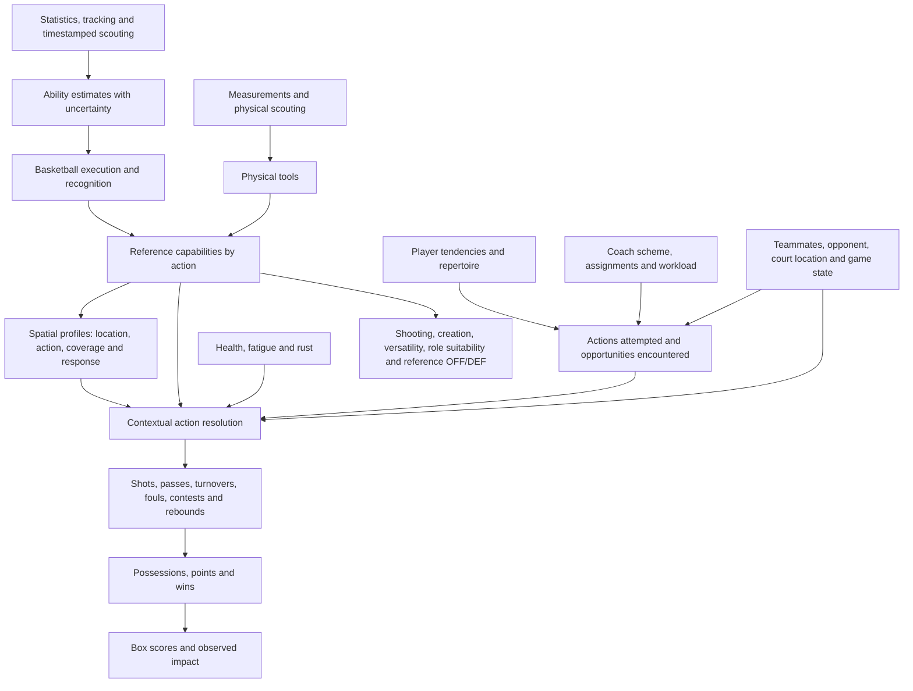
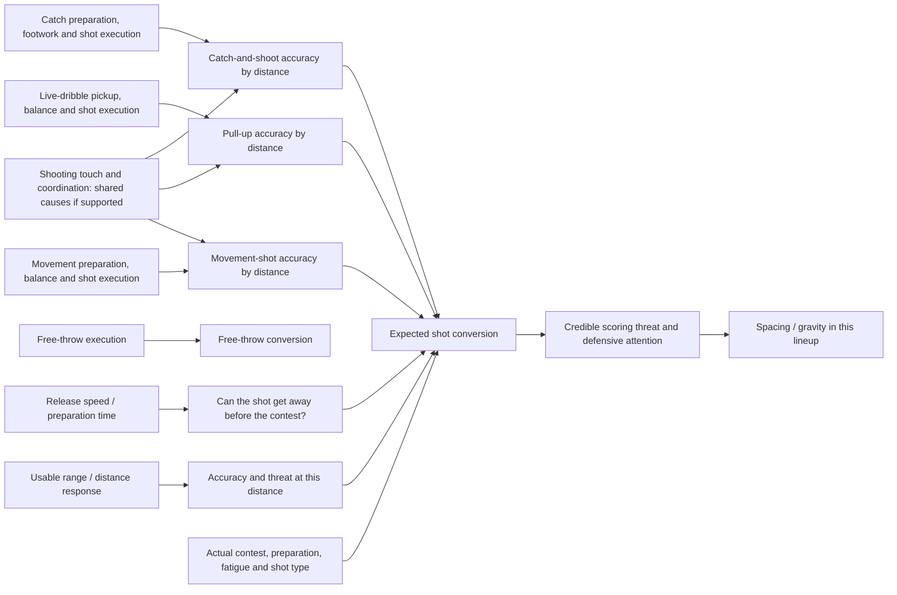
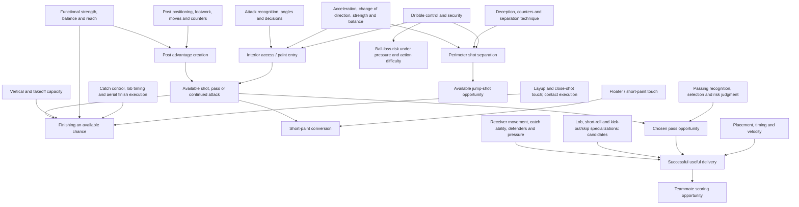
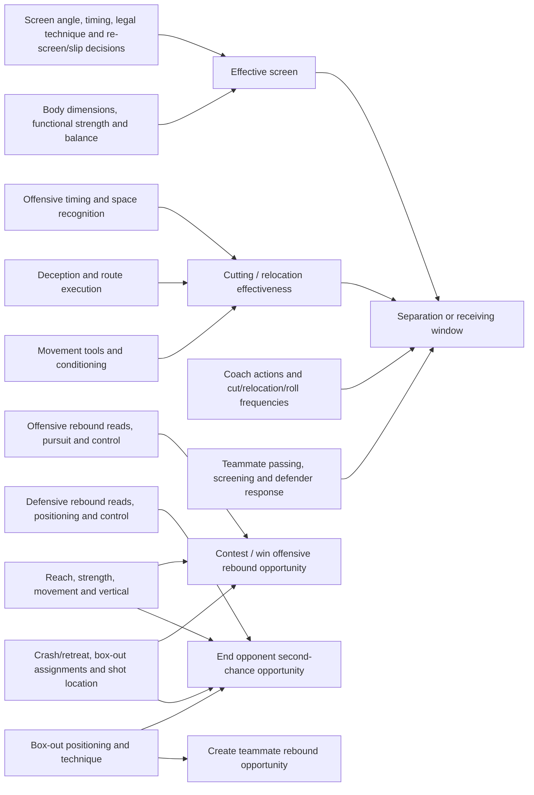
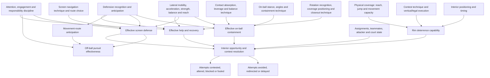
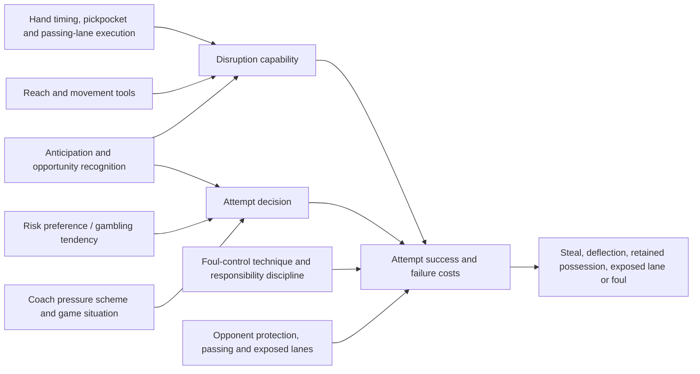

# Player skill dependency map

Discussion draft incorporating the user's November 11 annotations. This expands, rather than approves, the earlier 21-ability blueprint. No production code, ratings, engine weights or UI changed. No new work was delegated. BBI access and field coverage still need verification before finalizing stored ratings.

November 12 expansion: [Player object: explicit three-column dependency map](PLAYER_OBJECT_THREE_COLUMN_MAP_2026_11_12.md) carries the current desired architecture, full input/output inventories, passing recognition/execution pairs and spatial-profile contract. Where this earlier draft calls those passing pairs merely candidates, the newer document records the user's explicit requirement. Neither document implements the model.

## How to read the map

- A named mechanism is not automatically a separate stored rating or visible bar. Preserve the distinctions first; decide storage and presentation after checking evidence and gameplay consequences.
- Physical tools describe capacity. Basketball skills describe execution and recognition. Both belong to the player, but keeping their meanings separate prevents duplicate bonuses.
- Tendencies describe what a player tends to try; coach assignments describe what the team asks. Neither guarantees compliance, success or the chance to attempt the action.
- Derived capabilities describe how tools and skills combine under stated reference conditions. Actual game effects depend on opportunities, teammates, opponents and current state.
- Arrows indicate dependencies, not additive bonuses or approved coefficients. A summary must not be fed back alongside all its ingredients as another source of ability.
- Every proposed value needs source/date, reference conditions, uncertainty and physical-inclusion semantics. Measured effective performance must not receive a second blanket bonus for the physical tools already reflected in that measurement.

This is a desired dependency structure, not a claim that the current simulator resolves each possession this way. The current team-score-first engine will need explicit, bounded consumer changes so new skills change expected scoring and possession outcomes, not merely the presentation of a predetermined score.

## Physical tools

| Candidate tool | Meaning and important boundary |
|---|---|
| Height, wingspan, standing reach, mass | Observations, not interchangeable with functional strength or talent. |
| Acceleration, first step | How quickly the player gains speed; distinct from maximum speed. |
| Straight-line speed | Movement capacity over distance; not lateral technique. |
| Lateral mobility / change of direction | Without-ball physical redirection, deceleration and balance capacity. With-ball redirection combines this tool with dribble control/security and technique. Evidence may support one broad physical field rather than several. |
| Functional strength, balance | Applying and resisting force in basketball positions; not inferred from mass alone. |
| Vertical  | Jump reach beyond standing reach; repeated-jump ability remains a possible refinement, not an approved extra rating. |
| Conditioning, recovery between efforts | Sustaining and recovering from workload. Separate from health, effort decisions and opportunity-based minutes. |

## Offensive map

### Shooting

Catch shooting, pull-ups and movement shooting are distinct execution capabilities, not merely different usage counts. They can be modeled with shared and specific factors without assuming one universal shooting skill or making pull-ups only a penalty to catch shooting. The final representation must allow contrasting player profiles.

Candidate evidence dimensions: catch/pull-up/movement execution at three-point distance; midrange execution and context where supported; free throws; release timing; distance capability. Movement and catch can overlap on the same shot, so they must not be blindly added or treated as necessarily disjoint statistical categories. Low usage does not establish inability.

Release speed has no direct talent link to free-throw accuracy. Range does not grant gravity without a credible threat to attempt and make the shot. Defensive attention is an opponent response, not an extra shooting bonus.

### Creation, post play, finishing and passing

The access, finish and foul mechanisms stay distinct. A threatening floater can change defensive choices; it does not retroactively prove explosive first-step ability. Assisted versus self-created is opportunity context, not an exhaustive execution taxonomy: a pass can lead to a difficult contact layup, an easy dunk or a demanding lob catch.

Foul drawing is a candidate execution/decision capability applied within an attack and defender context. Awarded free throws then use free-throw skill. Avoid rewarding one FTr observation independently as superior speed, finishing, foul drawing and shooting accuracy.

Post craft is not a synonym for driving or generic handle. Post advantage can lead to a finish, jumper, foul or pass. A derived post-offense summary may combine them, but must not also add itself to those ingredients.

Passing specializations remain in the design map. Whether they become separate stored fields, conditional profiles or shared delivery plus uncertainty depends on evidence. Do not silently drop them to meet a rating-count target. Experience can support a scouting estimate; minutes do not mechanically create intelligence.

### Off-ball execution, screening and rebounding

Off-ball frequency is usage; route execution is not. Its exact stored decomposition is unresolved. Likewise OREB/DREB can be useful effective ability grades without requiring separate bars for every underlying read or movement. Box-out value must be able to appear as a teammate's rebound, not only the acting player's statistic. The possession model must conserve missed-shot/rebound opportunities.

## Defensive map

### Positioning and recovery are not single vague ratings

| Context | Positioning means | Recovery means |
|---|---|---|
| On-ball | Stance, angle, distance and alignment relative to the handler and available lanes | Re-establish useful containment after separation/contact; includes recognition, change of direction, footwork and legal execution |
| Interior | Depth and angle relative to rim, attacker, roller and ball; vertical contest access | Regain contest coverage after a move/help commitment without uncontrolled contact |
| Help / rotation | Off-ball starting location, gap coverage, tags, stunts, rotations and handoffs | Return to an assignment or cover the next threat after helping; includes reading the next job, travel and controlled closeout |
| Screen / pursuit | Approach angle and route relative to screener, receiver and coverage plan | Reattach or reconnect with the coverage after navigating the obstacle |

These can share recognition, mobility and technique without requiring four independently stored recovery numbers. **Recovery is not just lateral speed:** recognizing the need sooner, choosing the right route and arriving under control matter too. Interior positioning and broader rotation recognition are related but not interchangeable.

### On-ball, screens, help and rim deterrence

Rim deterrence remains the proposed user-facing name. The mechanism comprises contest technique, **interior positioning**, and functional physical coverage; opponent avoidance is an outcome and evidence. A longer reach is not added again if the imported effective-rim grade already includes its benefit. Helpers and perimeter containment alter which opportunities arrive; do not attribute all team avoidance to the center.

Helper/POA/chaser/wing-stopper/mobile-big/anchor are assignments. Their suitability is derived from the underlying capabilities. Selecting a role never grants a skill boost. Sheltered assignments still require useful positioning, communication, closeouts and rebounds, while teammates cover a larger share of difficult work. Low activity is not a seventh elite skill.

### Disruption, discipline and choices

Disruption skill, decision quality and risk preference are different. A player can execute difficult steals well yet attempt them too often. Fouling can be a consequence of poor technique or late recovery, not merely a voluntary tendency. Steals must correspond to opponent turnovers; deflections need not change possession; blocks must be compatible with opponent shot attempts. Better handle security must affect ball-loss risk, with difficulty and offensive exposure held comparable.

## Derived summaries and genuine game effects

| Summary / effect | Proposed derivation and boundary |
|---|---|
| Shot versatility | Breadth of credible scoring threats across locations and execution types. Not count of populated source fields, attempts alone or a separate trainable bonus. |
| Creation | A profile of perimeter separation, interior access, post advantage and passing-created opportunities. One headline cannot replace the component profile. |
| Finishing / post offense | Contextual execution from the relevant skills, tools and chance quality; not access plus finishing counted twice. |
| Spacing / gravity | Opponent response to credible shooting/creation threats, usable range, willingness and lineup context. |
| Defensive role suitability | Capability for a specified responsibility; no independent skill award or universal maximum-role DEF. |
| OFF / DEF / OVR | Reference summaries whose conditions and limits are stated. Do not feed them back as independent skill bonuses after using their constituents. |
| Team/game impact | Opportunities and resolution under lineups, tactics, opponents, health and fatigue; drives possessions and expected points, not just decorative box-score changes. |
| Financial and roster value | Basketball contribution plus age/development uncertainty, contract obligations, health and team needs. Not another hidden shooting or defensive skill. |

Health/fatigue/rust modify current capacity; development changes underlying abilities over time. Potential is not present skill. Morale, work ethic and coachability require separately defined mechanics/evidence before being treated as ability multipliers. This map does not approve new personality fields or coach tuning.

## Decisions still open

1. Shooting representation must permit independently strong/weak catch, pull-up and movement execution while sharing justified underlying causes. Range and release stay represented; exact storage and scale wait for evidence.
2. Post moves, contact resistance, passing specializations, off-ball technique and physical subtools remain visible in the conceptual map. No decision to delete them to hit 21 fields; no decision to invent precise unsupported grades either.
3. Effective grades versus technique-only inputs need explicit contracts. BBI modeled results cannot be relabeled as pure technique and then receive all physical advantages again. Some mechanisms may initially stay explanatory latent components rather than separately identifiable numbers.
4. Raw/scouting input estimation and the game dependency graph are different jobs. Outcomes can inform skill estimates with opportunity controls; do not circularly use our own simulated outputs to prove those skills are correct.
5. Prototype the accepted rim family first, then add other accepted families with contrasting-player and single-variable tests. Imported and generated players must share meaning and response, without repairing entry-scale mistakes through growth tuning.
6. The confirmed current release-to-FT link, missing direct handle-to-individual-loss effect, field-coverage-based versatility and score-first integration issues remain explicit implementation items. None was changed by writing this map.

## Verification criteria for future implementation

- Faster release changes available release/contest windows, not free-throw talent.
- Better handle security reduces loss risk at comparable usage/pressure; it need not reduce raw turnovers if the player takes on much more difficult creation.
- Better catch shooting need not improve pull-ups, movement shooting or free throws. Shared improvements occur only through a documented shared cause.
- Better floater touch changes appropriate short-paint outcomes and defensive choices without automatically increasing first-step speed.
- Better pass decisions and better delivery produce distinguishable improvements; assists still depend on teammate conversion.
- Better box-outs can improve team possession security without increasing that player's personal rebound count.
- Stronger rim deterrence improves relevant interior outcomes without awarding perimeter navigation or attributing all teammates' help to the anchor.
- A fast mover can still rotate late or choose the wrong pursuit route. Better recognition changes response timing, not the measured speed itself.
- Increased gambling can raise both steal opportunities and exposure costs; elite disruption does not erase decision mistakes.
- Equal player ability cannot change just because an importer has fewer populated columns, a roster changes, or a coach changes minutes.
- New ratings must affect expected possessions/points where intended, maintain coherent box-score accounting, and preserve deterministic daily/bulk behavior within the new model.

This document adds no final numeric weights, no definitive number of stored ratings and no production changes. It is the expanded conceptual map for the next human/data review.
