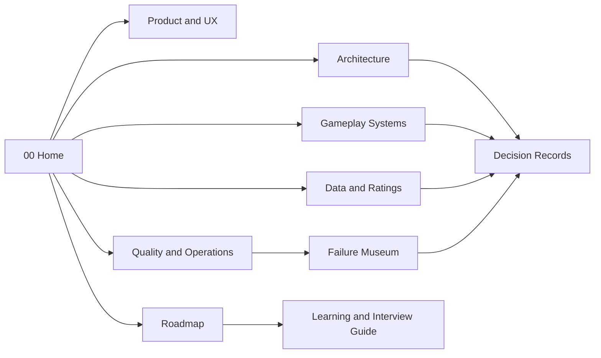

# NBA GM Knowledge Graph

> A deterministic, save-backed NBA general-manager sandbox whose Python engine models games, rosters, transactions, contracts, draft assets, health, staff, development, league events, and optional local-LLM narrative. A CLI remains the broadest interface while a local dashboard GUI is being built on a JSON action boundary.

## Start Here

- [[Maps/Architecture MOC|Architecture]] - boundaries, state, lifecycle, determinism, persistence, and platform adapters.
- [[Maps/Gameplay Systems MOC|Gameplay Systems]] - simulation, transactions, contracts, draft, health, staff, narrative, playoffs, and more.
- [[Maps/Data MOC|Data and Ratings]] - provenance, schema, build pipeline, overrides, calibration, and confidence.
- [[Maps/Product and UX MOC|Product and UX]] - product philosophy, CLI-to-GUI evolution, dashboard design, and outside software.
- [[Maps/Quality and Operations MOC|Quality and Operations]] - tests, performance, security, failures, risks, and release readiness.
- [[Maps/Decisions MOC|Architecture Decision Records]] - concise arguments for major choices and the alternatives not taken.
- [[Maps/Learning MOC|Learning Path]] - guided code tour, glossary, resources, interview defense, and self-test prompts.
- [[Roadmap/Next Development Phases]] - sequenced future work without confusing it for current functionality.

## The Project In One Sentence

The game is a mutable league save layered over a reproducibly built canonical basketball universe, advanced by deterministic domain services and exposed through both a large CLI orchestrator and a newer JSON-driven local GUI.

## Scale At This Snapshot

| Measure                                    |                       Snapshot |
| ------------------------------------------ | -----------------------------: |
| Python, GUI, test, and documentation lines | about 52,500 before this vault |
| Foundation tests                           |                            176 |
| Canonical teams                            |                             30 |
| Canonical players                          |                            526 |
| Player traits                              |                          7,890 |
| Draft picks                                |                            402 |
| Draft prospects                            |                             60 |
| Gameplay staff slots                       |                            180 |
| Canonical JSON size                        |                    about 22 MB |
| Git commits reviewed                       |                             31 |

The size is not the point by itself. The important complexity comes from cross-system state: a trade can affect rosters, salary, picks, rotations, team quality, standings, AI strategy, social output, and future draft ownership. See [[Architecture/Persistence and Mutation Safety]].

## Core Mental Model

1. [[Data/Canonical Build Pipeline|Build]] a canonical universe from raw evidence, research caches, model configuration, and overrides.
2. [[Architecture/Canonical Universe and Save Overlay|Layer]] a mutable save over that canonical base.
3. [[Architecture/Season State Machine|Advance]] time through legal phases and ordered side effects.
4. [[Systems/Simulation Engine|Simulate]] games with deterministic randomness and context-aware feature vectors.
5. [[Systems/Transactions and Asset Valuation|Let AI and users act]] under legality, fit, value, and timing constraints.
6. [[Architecture/Action Boundary and Local GUI|Present]] the same engine through interface adapters without moving rules into the UI.
7. [[Quality/Testing Strategy|Defend]] invariants with a large regression-oriented test suite.

## Honest Status

The domain engine is unusually broad for a personal sports-management project and many league loops are playable across seasons. It is not yet a finished commercial game. The GUI is visually ambitious but still carries layout debt and incomplete parity; the CLI is large and tightly coupled to presentation; the action API needs broader coverage; full-CBA behavior is intentionally incomplete; packaging for standalone iPhone execution remains a proposal rather than a shipped artifact. See [[Roadmap/Current State Assessment]] and [[Quality/Risk Register and Technical Debt]].

## Source Anchors

- [Package root](../../src/nba_gm_data)
- [Core test suite](../../tests/test_foundation.py)
- [Project configuration](../../pyproject.toml)
- [Primary README](../../README.md)
- [Existing GUI architecture note](../gui_architecture.md)
- [Existing GUI functional audit](../gui_functional_audit.md)

## Questions This Graph Should Answer

- Why is the engine in Python? [[Decisions/ADR-003 Python Engine Is Authoritative]]
- Why is a save an overlay instead of a copied universe? [[Decisions/ADR-001 Canonical Base Plus Save Overlay]]
- How can randomness still be reproducible? [[Decisions/ADR-002 Deterministic Seeded Simulation]]
- Why was same-day game parallelism deferred? [[Decisions/ADR-007 Sequential Advancement With Checkpoints]]
- Why are displayed ratings different from engine values? [[Decisions/ADR-008 Engine Ratings vs Display Ratings]]
- How does the LLM avoid changing game facts? [[Systems/Narrative Engine]]
- What has broken repeatedly, and what did it teach us? [[History/Failure Museum]]
- What should be done next? [[Roadmap/Next Development Phases]]

