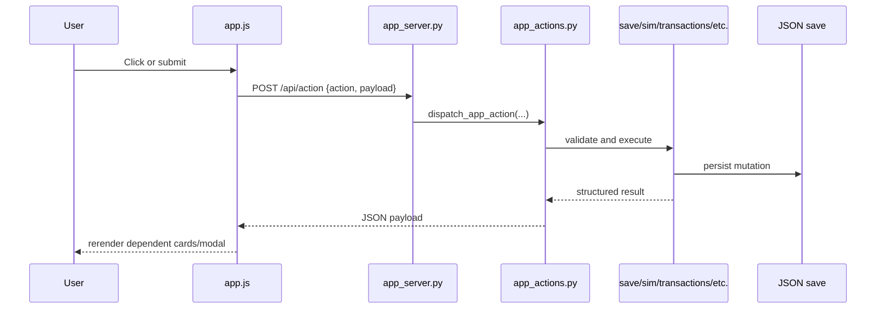

# Action Boundary And Local GUI

## Current Shape

The GUI is a local dashboard implemented in plain HTML, CSS, and JavaScript. [app_server.py](../../../src/nba_gm_data/app_server.py) serves static files and accepts `POST /api/action`. [app_actions.py](../../../src/nba_gm_data/app_actions.py) dispatches JSON-compatible actions into Python domain functions. The browser client in [app.js](../../../src/nba_gm_data/gui/app.js) renders payloads and sends user intent.

## Why An Action API Instead Of Calling CLI Menus?

CLI menu functions assume terminal input, synchronous prompts, and formatted text output. A GUI needs structured state, explicit choices, cancelable dialogs, and predictable errors. Calling menu code would force the browser to parse text or emulate stdin.

The action layer is an application-service boundary:

- accepts plain values;
- validates required context;
- calls domain helpers;
- mutates and saves under a per-save lock when needed;
- returns serializable view models and next legal actions.

## Concurrency Boundary

The local server uses `ThreadingHTTPServer`, so two browser requests can overlap. `app_actions.py` maintains per-save reentrant locks around mutations. This protects against simultaneous “advance” and “trade” requests writing the same file.

This is process-local protection, not a distributed lock. It is appropriate for one local app process, not a multi-user hosted service.

## Cache And Refresh Behavior

The server deliberately sends no-store headers for rapidly changing static frontend assets during development. This supports immediate CSS/JS refreshes. Runtime data still comes from actions, so backend changes or save loads naturally require requests.

## Current GUI Strengths

- Dense first-screen management dashboard.
- Shared cards for identity, ratings/stats/contracts, rotation, staff, calendar, standings, leaders, development, free agents, events, draft assets, and front-office actions.
- Modal workflows for actions such as trade offers and finders.
- Team switching for read-only league inspection.
- Local-only operation without a hosted account.

## Current GUI Risks

- Large `app.js` and `styles.css` files now encode many one-off layout decisions.
- Some UI rooms still do not have full CLI action parity.
- Manual widths and offsets have caused overlap and viewport-specific regressions.
- The API's view models are not yet formally versioned beyond a broad v1 marker.
- Browser tests and visual regression coverage are thin compared with engine tests.

See [[Product/Dashboard Design]] and [[Quality/Risk Register and Technical Debt]].

## Why Not React Yet?

React was discussed in forward-looking GUI plans, but the implemented client is vanilla JavaScript. That choice avoided introducing a build toolchain during rapid prototyping and kept packaging simple. As component state and layout complexity grow, a component framework may become valuable, but a rewrite should be justified by measured maintenance costs and protected by action-level tests.

## Mobile Direction

Standalone iPhone execution requires embedding Python or porting the engine. The chosen direction is an embedded CPython runtime with a native shell or packaged shared frontend, keeping Python authoritative. That work is not complete. See [[Product/External Software and Packages]] and [[Roadmap/Next Development Phases]].

## Related Decisions

- [[Decisions/ADR-003 Python Engine Is Authoritative]]
- [[Decisions/ADR-004 Dependency-Light Standard Library Runtime]]

