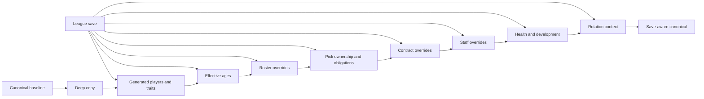

# Canonical Universe And Save Overlay

This is the most important state model in the project.

## The Two Worlds

### Canonical Universe

The canonical universe is a reproducible baseline built from evidence and configuration. It contains teams, players, traits, roster assignments, contracts, draft assets, prospects, staff, health profiles, sources, and coverage issues. The records are represented by frozen dataclasses in [schema.py](../../../src/nba_gm_data/schema.py) and serialized to a roughly 22 MB JSON artifact.

### League Save

A league save contains everything that can diverge during play: current date and phase, team records, results, player stats, roster and contract overrides, health state, development, pick ownership and obligations, generated players, staff changes, transactions, events, offers, morale, narrative cache, playoff/draft/free-agency state, and history.

The save does not need to clone every baseline record. It stores changes and evolving state.

## Enrichment

At runtime, [canonical_with_save](../../../src/nba_gm_data/save.py) creates an active view:

Derived transaction and simulation caches are invalidated when their inputs change. The active view is disposable and can be rebuilt from the canonical base plus the save.

## Why Not Mutate Canonical Data Directly?

Direct mutation would be simpler for a single play session but harmful over time:

- Two saves could contaminate one another in the same process.
- A rebuild could overwrite gameplay state or make old saves impossible to interpret.
- Tests would depend on execution order.
- Generated rookies and future staff would leak into the global baseline.
- Comparing the active league with its original data would become difficult.

The overlay adds enrichment cost and requires explicit invalidation, but it creates a recoverable source of truth.

## Existing Save Compatibility

[ensure_league_save_defaults](../../../src/nba_gm_data/save.py) acts as an opportunistic migration layer. Missing fields are initialized, older obligation structures are repaired, and newer gameplay defaults are introduced without demanding a separate manual migration command.

This is pragmatic for a private alpha with frequently evolving saves. Its risk is that migration and normal read paths can blur together. A future public beta should introduce explicit save schema versions and idempotent migration steps. See [[Quality/Risk Register and Technical Debt]].

## Invariants

1. Baseline canonical input must not be mutated by a save action.
2. Save-aware enrichment must be idempotent for unchanged inputs.
3. A save override must take precedence over baseline data for that save.
4. New canonical corrections should appear in old saves unless the save explicitly overrides the field.
5. Generated entities need stable IDs and the same schema shape as baseline entities.
6. Derived caches must be invalidated when records, season, roster, picks, health, or relevant overrides change.

## Failure Modes This Model Prevents

- Current-season contracts disappearing when future extensions are applied.
- Players remaining in stale team rotations after a trade or retirement.
- Draft ownership displays reading baseline owners after a lottery resolution.
- One game's derived team features being reused after a roster mutation.

Not every historical bug was prevented automatically because some views bypassed or incompletely enriched the model. Those cases are documented in [[History/Failure Museum]].

## Alternatives Considered

### Full Save Snapshot

Store the entire universe in every save. Reads are simpler, but files grow, canonical corrections cannot naturally flow into old saves, and migrations touch far more data.

### Event Sourcing

Store only immutable events and rebuild current state by replay. This gives exceptional auditability but would greatly increase implementation complexity, replay time, migration requirements, and event-schema discipline. The current transaction/event logs are useful but not complete enough to be the sole source of truth.

### Relational Runtime Database

Use SQLite as the live source for all state. This improves querying and transactional integrity, but adds object-relational mapping and migration work. [storage.py](../../../src/nba_gm_data/storage.py) can export canonical data to SQLite, so the option remains open for analytics or later runtime evolution.

## Related Decision

[[Decisions/ADR-001 Canonical Base Plus Save Overlay]] formalizes this choice.

