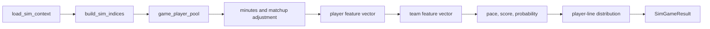

# Core Logic And Code

This note is the function-level map between conceptual architecture and source. Line numbers will drift, so search by symbol.

## Build And Load

| Intent | Entry point | Owns |
|---|---|---|
| Build baseline universe | `ingest.build_universe` | ordered evidence normalization, calibration, records, audit |
| Serialize canonical | `schema.to_plain`, `storage.*` | plain JSON/SQLite representation |
| Load active save | `save.load_save` | JSON read only |
| Backfill evolving save | `save.ensure_league_save_defaults` | idempotent compatibility/defaults/repairs |
| Produce active universe | `save.canonical_with_save` | canonical copy + all save overlays + derived invalidation |

Read [[Data/Canonical Build Pipeline]] before changing `build_universe`. Read [[Architecture/Canonical Universe and Save Overlay]] before changing `canonical_with_save`.

## Time And Season

| Intent | Entry point | Key contract |
|---|---|---|
| Create save | `save.create_league_save` | complete initial mutable state and seed |
| Determine legal actions | `save.legal_actions_for_date` | one legality vocabulary for interfaces |
| Advance date/range | `save.advance_save` | cross every causal checkpoint in order |
| Advance one game | `sim.sim_game_with_context` | deterministic result from active snapshot |
| Change phase | save phase helpers | initialize required phase state before views/actions |
| Roll season | `save.complete_offseason_and_rollover` | archive, retire, transition, schedule, reset |

The dangerous mistake is calling a lower-level helper without the lifecycle work that makes its result authoritative. GUI actions should compose through application services, not directly mutate collections.

## Simulation

Important supporting boundaries:

- `health.sandbox_health_adjusted_pool` controls availability.
- save game-recording helpers own persisted logs and stats.
- feature caches are valid only for unchanged active canonical input.

## Transactions

| Stage | Functions/concepts |
|---|---|
| Context | `with_transaction_context`, `build_transaction_context`, pick projection signature |
| Assets | player/pick/swap normalization and lookup |
| Value | player asset valuation, pick curve, contract surplus, package concentration |
| Team decision | `evaluate_trade_for_team`, strategy, fit, role, GM personality |
| Proposal decision | `evaluate_trade` |
| Legality | ownership, salary, roster, Stepien, timing, locked collateral |
| Apply | `apply_trade_to_save` plus stale-offer/roster/contract/pick cleanup |
| Conditional rights | `validate_pick_obligation_term`, term application, shared formatter |
| Resolution | `save.resolve_pick_obligations_for_year` |

Do not use a displayed asset label as input to value or transfer logic.

## Contracts And Markets

| Intent | Entry point |
|---|---|
| Market report | `contract_ai.contract_market_report` |
| Role tier | `contract_ai.contract_role_tier` |
| Comparable players | `contract_ai.contract_comps` |
| Team offer | `contract_ai.generate_team_offer` / `contract_offer` |
| Legality | `contract_ai.contract_legality` |
| Apply | `contract_ai.apply_contract_to_save` |
| In-season released signing | save released-free-agent processing helpers |

The contract record shown in every view should be the save-aware canonical contract after override merge.

## Draft

| Intent | Entry point |
|---|---|
| Future class | `draft.generate_draft_class_records` |
| Team-scoped display | `draft.draft_class_payload`, shared scout display helpers |
| Order/lottery | `draft.generate_draft_order`, `save.run_draft_lottery` |
| Team board | `draft.draft_board_report` |
| Selection score | `draft.draft_selection_score` |
| Apply selection | `draft.apply_draft_selection_to_save` |
| Rookie state | draft onboarding/contract/traits records |
| Draft trades | draft trade target, score, sweetener, save market hooks |

The saved live order, not a regenerated report, owns current slot/owner truth.

## Health, Development, And Staff

- `health.simulate_health`: date-range health/fatigue/injury evolution.
- `health.advance_development`: monthly trait events.
- `health.performance_staff_modifiers`: staff-to-health bridge.
- `staff.staff_team_report`: current role/effect view.
- `staff.negotiate_staff_hire`, `hire_staff_from_save`, `fire_staff_from_save`: user lifecycle.
- `staff.simulate_ai_staff_changes`: AI retention/firing/hiring/interim decisions.

## Events And Narrative

- `save.league_events_view`: factual event query/filter.
- `narrative.social_context_packet`: bounded source facts.
- `narrative.social_cache_entry`: generation, parse, validate, fallback, cache.
- `narrative.hydrate_social_items`: lazy bounded view generation.
- `narrative.press_cache_entry`: optional press mini-game generation.

The only permitted direction is fact -> packet -> prose. Never parse generated prose back into league state.

## GUI Request Path

1. `app.js` event handler builds intent payload.
2. Fetch sends `POST /api/action`.
3. `app_server.py` decodes and calls `dispatch_app_action`.
4. `app_actions.py` resolves save, locks mutations, and calls a domain service.
5. Domain code writes the save and returns structured data.
6. `app.js` updates local view state and rerenders affected components.

If GUI and CLI results differ, compare at step 4 first. If domain state matches, it is a view-model/rendering bug. If state differs, it is orchestration or domain behavior.

## Code Change Checklist

- Which module owns the rule?
- What is authoritative input and output?
- Is this a pure calculation, derived cache, domain mutation, or UI render?
- What save collections and views depend on it?
- What invalidates related caches?
- Is cancellation mutation-free?
- Does the same action work through CLI and GUI?
- Which regression and lifecycle tests prove it?

## Related Notes

- [[Architecture/Module Map]]
- [[Quality/System Invariant Matrix]]
- [[Learning/Guided Code Tour]]

