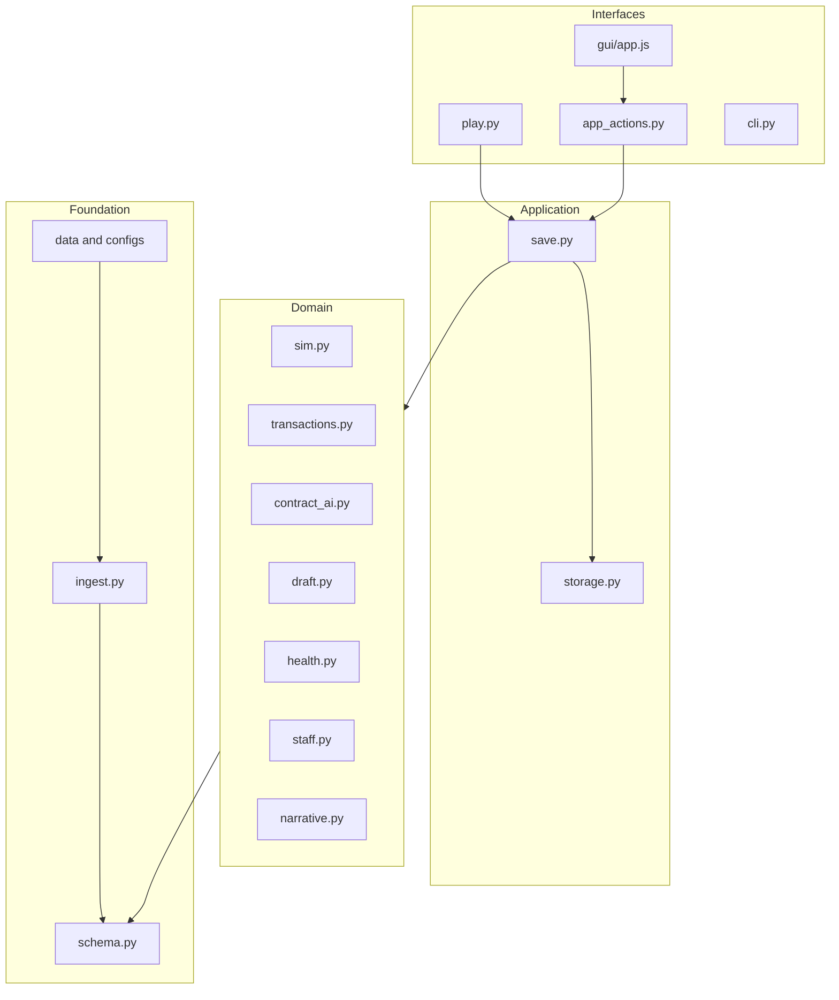

# Module Map

## Size Is A Signal, Not A Verdict

The largest files reflect the order in which the project evolved. The CLI and save lifecycle became integration hubs, transactions accumulated many asset and legality variants, and the GUI grew through rapid dashboard iteration. A large file is not automatically wrong, but it reveals where ownership boundaries deserve scrutiny.

| Module | Approx. lines | Main responsibility | Architectural note |
|---|---:|---|---|
| `play.py` | 8,095 | Interactive CLI and workflow orchestration | Broadest feature parity, but presentation and domain sequencing are coupled |
| `save.py` | 7,255 | Save creation, enrichment, advancement, phases, events, rollover | Central integration boundary; changes have high blast radius |
| `tests/test_foundation.py` | 5,105 | End-to-end regression foundation | Strong breadth, slow monolithic organization |
| `transactions.py` | 4,021 | Asset values, trade generation, legality, obligations | Complex because value, context, identity, and state transition meet here |
| `gui/app.js` | 3,740 | Dashboard state, rendering, actions, modals | Dependency-free but manual DOM/layout complexity is growing |
| `gui/styles.css` | 3,201 | Dense dashboard layout and visual system | Repeated positional adjustments indicate missing layout primitives |
| `sim.py` | 2,553 | Game features, minutes, probabilities, box score generation | Numerically central and performance-sensitive |
| `narrative.py` | 2,417 | Ollama provider, packets, prompts, validation, cache, fallback | Correctly isolated from simulation, but validation logic is extensive |
| `draft.py` | 1,962 | Classes, scouting, lottery, AI selection, trades, rookie onboarding | Mixes data generation, information fog, and draft state |
| `research.py` | 1,907 | Public-source research/cache handling | Build-time evidence collection, not runtime gameplay |
| `ingest.py` | 1,677 | Deterministic canonical build | Order-sensitive transformation pipeline |
| `app_actions.py` | 1,608 | JSON-compatible GUI action services | Strategic seam for interface independence |
| `contract_ai.py` | 1,584 | Contract market, asks, extensions, free agency | Models negotiation and cap legality together |
| `staff.py` | 1,289 | Staff market, effects, hiring/firing | Six-role fictional staff simulation |
| `cli.py` | 1,162 | Command-line entrypoints and data commands | Distinct from the interactive play room |

## Layered View

The diagram is conceptual. Python imports are not perfectly one-directional, and `save.py` deliberately coordinates many domain modules.

## Ownership Rules To Preserve

- `schema.py` defines canonical record shape, not gameplay behavior.
- `ingest.py` builds baseline truth, not save-specific state.
- `save.py` owns lifecycle ordering and save compatibility.
- A domain module should own its calculations and state transition helpers.
- `app_actions.py` should compose domain actions for clients, not duplicate formulas.
- `app.js` should manage interaction and rendering, not decide trade legality or simulation outcomes.

## Refactoring Direction

Do not split files merely to reduce line counts. Extract around stable capabilities:

1. Save migration and validation from general save views.
2. Phase-specific application services from the CLI menu loop.
3. Pick obligation lifecycle from general transaction evaluation.
4. GUI layout tokens/components from card-specific CSS offsets.
5. Test fixtures and scenario builders from one large test class.

Each extraction should preserve behavior through characterization tests. See [[Quality/Testing Strategy]] and [[Roadmap/Next Development Phases]].

## Related Notes

- [[Architecture/System Context]]
- [[Architecture/Persistence and Mutation Safety]]
- [[Quality/Risk Register and Technical Debt]]
- [[Learning/Guided Code Tour]]

