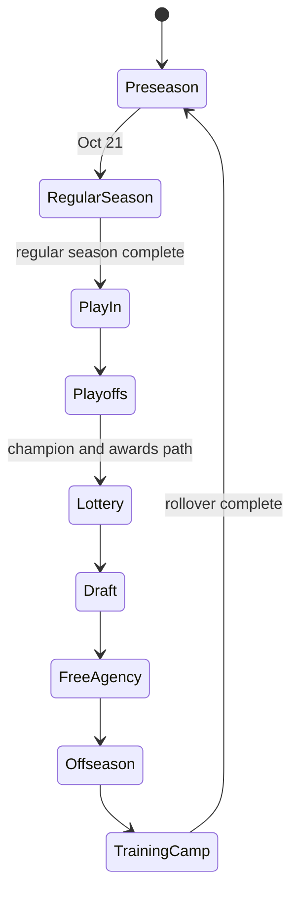

# Season State Machine

The game is not just a calendar with menus. It is a temporal state machine in which available actions, AI behavior, roster rules, and transition work depend on date and phase.

## Major Phases

Dates and exact transitions are implemented in [save.py](../../../src/nba_gm_data/save.py). The current starting framework treats Oct 1-20 as preseason and Oct 21-Apr 12 as regular season, with explicit post-season and offseason phases layered after that.

## Legal Action Gates

`legal_actions_for_date` derives whether trades, extensions, signings, and phase-specific actions are available. This prevents a GUI or CLI room from defining legality independently.

Examples:

- Trade offers expire or are cleared around the deadline.
- Recently signed and recently traded restrictions depend on league date.
- Extensions use eligibility and future contract years.
- Draft actions require a live draft state and an unselected exact pick.
- Free-agency advancement resolves offers and AI activity in day-sized steps.

## Ordered Advancement

`advance_save` is an application transaction over a time interval. Its current high-level order is:

1. Determine the target date and scheduled games.
2. Advance health, availability, and fatigue into the relevant dates.
3. Build a save-aware canonical view and reusable simulation context.
4. Simulate scheduled games in deterministic order.
5. Apply monthly development checkpoints when crossed.
6. Update phase and expire stale offers.
7. Prepare phase state and normalize roster/rotation concerns.
8. Process in-season released-player signings.
9. Queue AI recommendations, social facts, staff drama, and rare events.
10. Persist state and process eligible AI actions.

The exact details are more nuanced, but the ordering is itself behavior. For example, health must be known before a game selects participants, and a trade after the deadline must not be applied merely because it was generated earlier.

## Why Not Jump Directly To A Target Date?

The interface may offer “Sim Month” or “Trade Deadline,” but the engine must still cross intermediate checkpoints. Team records and needs at the deadline depend on games, injuries, development, trades, and staff events that happened first. The UX can collapse the wait; the model cannot collapse causal history.

## Rollover

`complete_offseason_and_rollover` is one of the heaviest transitions because it must:

- archive the season and awards;
- age players and evaluate retirements;
- move contract years and roster state;
- create or activate future prospects and rookies;
- generate the next schedule;
- reset seasonal stats, restrictions, histories, offers, and phase data;
- preserve multi-season information needed for AI decisions and development.

This explains both its test runtime and its risk. See [[Quality/Performance and Optimization]].

## Invariants

- Every simulated game date is not later than the active save date after advancement.
- A game is simulated at most once.
- State changes occur in chronological order when later decisions depend on earlier results.
- Phase-specific queues are initialized before their UI is reachable.
- Rollover preserves historical records while resetting season-local data.
- Actions legal before a deadline cannot remain silently actionable after it.

## Related Notes

- [[Decisions/ADR-007 Sequential Advancement With Checkpoints]]
- [[Systems/Playoffs Awards and Rollover]]
- [[Systems/Health Fatigue and Development]]
- [[Quality/Testing Strategy]]

