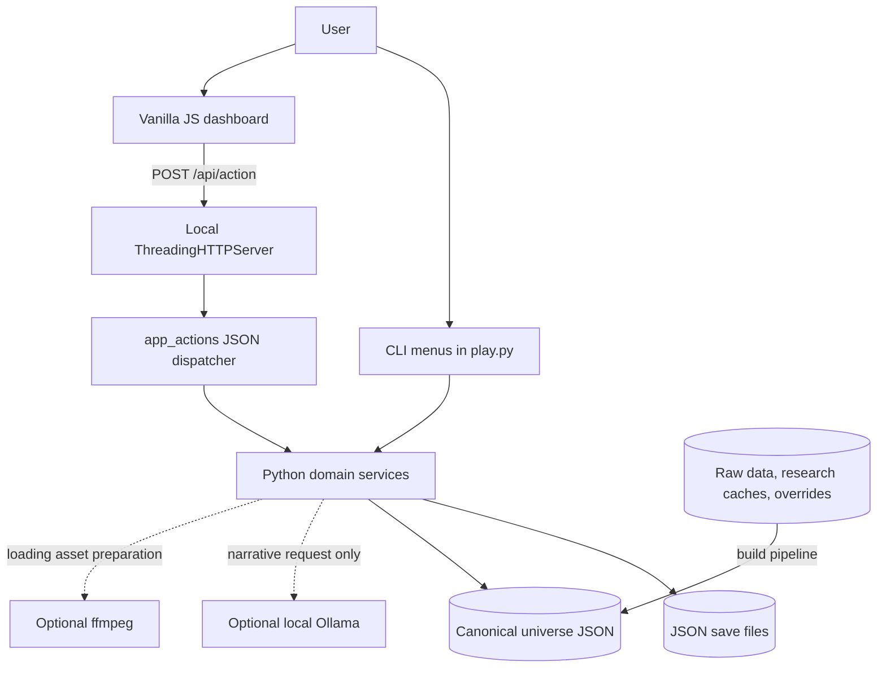

# System Context

## Purpose

The NBA GM sandbox lets a user control one franchise inside a persistent, multi-season league. The user can inspect the league, set rotations and a visual starting five, negotiate contracts, trade players and complex pick rights, manage staff, draft, navigate free agency, simulate games, and observe AI teams doing the same under deterministic rules.

The central architectural promise is that every interface asks one Python engine to perform those actions. Presentation may differ, but basketball rules and save mutations must not.

## Current Runtime Context

### What Is Authoritative

- The Python domain modules are authoritative for league behavior.
- The canonical universe is authoritative for reproducible baseline data.
- The active save is authoritative for mutable league history and overrides.
- The GUI DOM is never authoritative. It renders payloads and submits intent.
- Local-LLM output is never authoritative. It can rephrase supplied facts only.

## Major Boundaries

### Evidence Boundary

Public data, manual CSVs, research caches, and model configurations cross into a typed canonical universe through [[Data/Canonical Build Pipeline]]. Once normalized, runtime systems should not reach back into raw source files.

### Save Boundary

Runtime behavior uses a save-aware canonical view created by [[Architecture/Canonical Universe and Save Overlay]]. This prevents one save's trades, aging, generated rookies, or development from contaminating another save or the build artifact.

### Action Boundary

The GUI calls [app_actions.py](../../../src/nba_gm_data/app_actions.py) with JSON-compatible payloads. This is the beginning of a reusable application service layer, described in [[Architecture/Action Boundary and Local GUI]].

### Narrative Boundary

[narrative.py](../../../src/nba_gm_data/narrative.py) builds compact packets from sim state, calls optional Ollama, validates structured output, and caches or falls back. See [[Systems/Narrative Engine]].

## Deployment Reality

Today, the GUI is a local web application served by the Python process. It is not yet a standalone native iPhone application. The repository contains an architectural direction for embedded Python/native shells, but no shipped iOS package should be claimed. See [[Roadmap/Next Development Phases]].

## Why This Shape

The domain grew first and accumulated real complexity before a GUI existed. Rewriting the engine into a frontend framework would risk behavior drift across thousands of rules and regression cases. Keeping Python authoritative allows interface work to proceed independently while the existing deterministic foundation remains testable.

The cost is that some old CLI orchestration still sits outside ideal service boundaries. GUI parity therefore requires extracting workflows into actions, not merely calling menu functions. This is a key item in [[Quality/Risk Register and Technical Debt]].

## Source Anchors

- [CLI play loop](../../../src/nba_gm_data/play.py)
- [Application action boundary](../../../src/nba_gm_data/app_actions.py)
- [Local app server](../../../src/nba_gm_data/app_server.py)
- [GUI client](../../../src/nba_gm_data/gui/app.js)
- [Canonical schema](../../../src/nba_gm_data/schema.py)
- [Save lifecycle](../../../src/nba_gm_data/save.py)

## Related Decisions

- [[Decisions/ADR-003 Python Engine Is Authoritative]]
- [[Decisions/ADR-004 Dependency-Light Standard Library Runtime]]
- [[Decisions/ADR-006 Optional Sandboxed Local LLM]]

