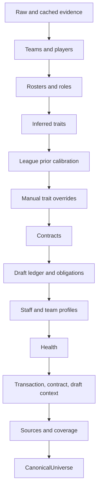

# Canonical Build Pipeline

## Entry Point

[ingest.py](../../../src/nba_gm_data/ingest.py) builds a deterministic `CanonicalUniverse`. The order is part of the model because later layers rely on earlier identities and distributions.

## Build Order

1. Load raw player inputs, research caches, aliases, and manual overrides.
2. Build 30 team identities.
3. Build player identities and normalize names/teams.
4. Build roster assignments and rotation context.
5. Infer base percentile traits from stats, role, and evidence.
6. Apply the league-wide human ratings prior through quantile calibration.
7. Apply manual trait overrides as final authority.
8. Build contract records and uncertainty metadata.
9. Build draft-pick ledger and structured startup obligations.
10. Build public staff/team context and fictional gameplay staff.
11. Build health profiles and startup injuries.
12. Build front-office/transaction context.
13. Build contract-market context.
14. Build draft prospects, reports, boards, and related context.
15. Emit source registry, coverage issues, validation summaries, and the aggregate universe.

## Why Order Matters

- Trait inference needs player and role identity.
- Quantile calibration needs the full league distribution.
- Manual overrides must apply after broad calibration or they would be diluted.
- Contract and transaction context needs resolved players/teams.
- Pick obligations need a complete pick ledger to validate fallback IDs.
- Health and staff effects need stable player/team identities.
- Audit output needs to observe every earlier transformation.

## Build Versus Runtime

The build pipeline may use cached public research and perform expensive league-wide calibration. Runtime gameplay should load the canonical artifact and never scrape external sites. Save-aware enrichment is a separate runtime process described in [[Architecture/Canonical Universe and Save Overlay]].

## Stale Canonical Detection

If an override file is newer than the prebuilt canonical JSON, play should rebuild or apply the updated override before starting. Otherwise a developer can correct a contract or height and still see stale data in the playable game. Timestamp checks are pragmatic; content hashes/build manifests would be more robust.

## Outputs

- canonical JSON used by play and tests;
- optional SQLite representation for analysis;
- source registry;
- coverage issues;
- calibration and validation summaries.

## Build Invariants

- Unchanged inputs produce logically identical output.
- Every player/trait/contract/pick reference points to a known identity.
- Manual final overrides win over broad inferred/calibrated values.
- Ambiguous human-prior matches are audited and not applied.
- Future picks and prospects remain separate ledgers.
- Coverage gaps remain visible rather than silently filled with misleading certainty.

## Testing

The suite checks core counts, deterministic rebuild, public-source population, known archetypes, override precedence, source/coverage presence, and canonical output writes. See [[Quality/Testing Strategy]].

## Related Notes

- [[Data/Data Provenance and Trust]]
- [[Systems/Ratings and Traits]]
- [[Data/Overrides and Model Configuration]]

