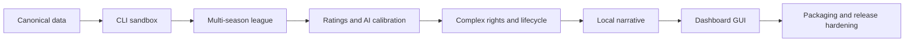

# Iteration Timeline

This timeline is reconstructed from Git history, tests, plans, and playtest notes. It records the major evolution rather than every commit.

## Phase 1: Data Foundation And Manifestos

**April 2026**

The project began by organizing public basketball data into a canonical foundation. Early work established teams, players, traits, source evidence, lineups, contracts, draft assets, staff context, validation, and team/GM “manifesto” expectations.

Key idea: build a reusable basketball universe before building a full game.

What this enabled:

- deterministic rebuilds;
- visible data gaps;
- explainable features;
- a schema broad enough for simulation and transactions.

## Phase 2: Playable Pre-Alpha

**Early June 2026**

Save creation, date advancement, schedules, game simulation, dashboards, playoffs, draft, free agency, contracts, and user/AI actions became a continuous CLI game.

The architecture shifted from “dataset with reports” to “mutable league layered over canonical data.” [[Decisions/ADR-001 Canonical Base Plus Save Overlay]] became the central model even before it was documented as an ADR.

## Phase 3: Multi-Season League Behavior

**June 11-19**

Development, health, future draft classes, contracts, AI trades, pick ledgers, awards, rollover, and generated schedules were expanded. Playtesting began to reveal lifecycle bugs that isolated feature tests could not:

- stale ownership after lottery;
- contracts losing current-year salary;
- AI actions applying at the wrong temporal checkpoint;
- retirees interacting with re-signing;
- rotations and stats retaining departed players.

The test suite evolved toward long save-backed scenarios.

## Phase 4: Ratings And Simulation Calibration

**June 20-23**

Random-team saves, contract/height corrections, player trait calibration, top-scorer/assist/DPOY tuning, and display ratings were added. A full-league subjective ratings prior was quantile-mapped into engine distributions so player truth could improve without destroying plausible standings.

Key lesson: aggregate realism can hide individual absurdity. Team standings alone are not enough to validate player ratings.

## Phase 5: Complex Draft Assets And Team Presentation

**June 24-26**

Structured protected picks, fallbacks, pick swaps, editable visual starting fives, expanded league events, draft-night AI trades, staff drama, trade finder improvements, and playoff UX were developed.

This period exposed the cost of using labels as state. Pick obligations needed exact IDs, lifecycle validation, locked collateral, rights transfer, resolution, and one shared formatter.

## Phase 6: Edge-Case Integrity And Performance

**Late June to early July**

Work focused on rejected-offer authorization, injured-star value, released-player AI signings, ghost stats, rookie protections, extension timing, AI staff markets, chronological AI operations, and safe performance optimizations.

The first optimization principle emerged: cache repeated enrichment/context before changing simulation semantics or parallelizing stateful work.

## Phase 7: Local Narrative Engine

**July 4-5**

The social/press system gained optional Ollama generation, strict JSON, personas, sim-only context packets, cache, fallback, and increasingly domain-aware validators.

Playtest feedback drove validation for:

- stale real-world affiliations;
- unsupported injuries/reputations;
- AAV versus contract total;
- conference and standings claims;
- cap/hard-cap posture;
- team ranking versus player rating;
- trade direction;
- teammate extension context;
- text truncation and repetitive fallbacks.

Key lesson: grounding is an application architecture problem, not solved by one prompt sentence.

## Phase 8: GUI Foundation And Dashboard Iteration

**July 5-10**

A platform-neutral action dispatcher and local HTTP server were added, followed by a dense vanilla-JavaScript dashboard. Rooms and cards expanded to include the player summary, identity, front office, starting five, staff, calendar, trends, standings, leaders, contracts, picks, events, markets, playoffs, draft, and free agency.

Visual iteration was extremely granular. The resulting screen is information-rich, but repeated pixel/width adjustments exposed the need for a stronger CSS Grid composition and visual regression testing.

## Project Evolution Diagram

## Iteration Pattern

The project has used a productive loop:

1. Implement a coherent feature.
2. Play through realistic and intentionally strange scenarios.
3. Capture failures as concrete output.
4. Infer the violated domain invariant.
5. Repair shared state/logic rather than only one screen.
6. Add regression tests.
7. Re-run the full suite and continue.

The risk is that rapid patches can accumulate in integration hubs and UI CSS. The next evolution should preserve the loop while adding explicit subsystem boundaries and scenario fixtures. See [[Roadmap/Next Development Phases]].

## Related Notes

- [[History/Failure Museum]]
- [[Quality/Testing Strategy]]
- [[Learning/Interview Defense Guide]]

