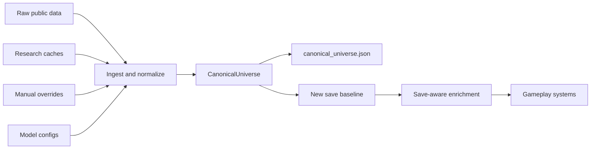

# Data MOC

The data foundation is a small provenance system, not just a collection of JSON files. It records where facts came from, how much to trust them, what remains missing, and which subjective corrections intentionally override inference.

- [[Data/Data Provenance and Trust]] - evidence classes, research caches, source registry, and confidence.
- [[Data/Domain Schema]] - immutable canonical records and plain serialization.
- [[Data/Canonical Build Pipeline]] - exact ingestion order and why order matters.
- [[Data/Overrides and Model Configuration]] - manual corrections, model versions, and the difference between facts and tuning.
- [[Systems/Ratings and Traits]] - the most consequential transformation from source evidence to engine behavior.

## Core Principle

Raw inputs are evidence, not truth. Canonical output is reproducible derived truth for a particular build version. Save state is mutable gameplay truth. Confusing those layers causes stale data, lost overrides, and non-reproducible bugs.

## Evidence Flow

## Audit Questions

- Can every authoritative field be traced to a source or override?
- Is a number a fact, an inferred feature, a display transform, or a gameplay tuning value?
- Does a rebuild produce byte-for-byte equivalent logical output from unchanged inputs?
- Do existing saves receive new canonical corrections without losing their own explicit overrides?

These questions connect directly to [[Quality/Testing Strategy]] and [[Decisions/ADR-001 Canonical Base Plus Save Overlay]].

