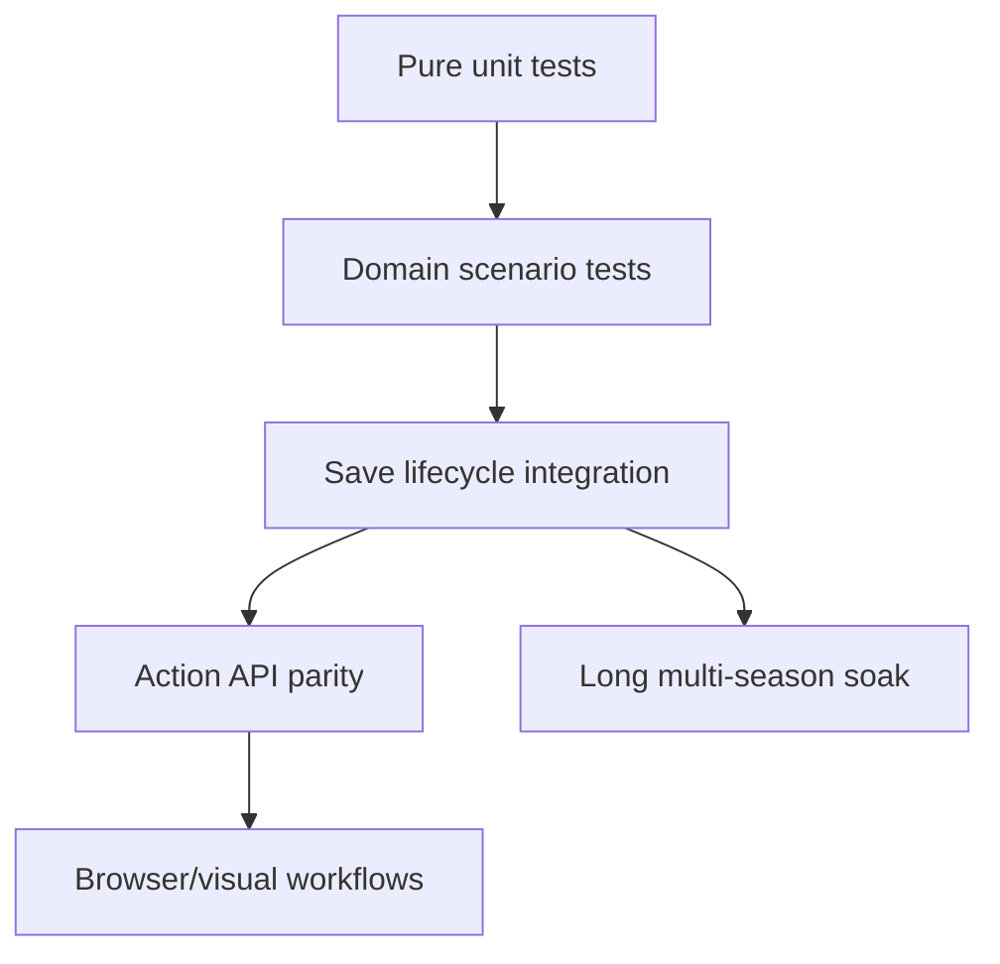

# Testing Strategy

## Current Suite

The main suite is [tests/test_foundation.py](../../../tests/test_foundation.py), containing 176 `unittest` tests at this snapshot. It covers canonical builds, ratings, game simulation, health, development, trades, picks, contracts, free agency, draft, staff, events, narrative, save advancement, rollover, CLI smoke paths, and selected GUI/action behavior.

Run it with:

```bash
PYTHONPATH=src python3 -m unittest discover -s tests -v
```

Long tests, especially rollover and multi-date simulation, are expected. Do not terminate the suite merely because output pauses.

## What The Suite Does Well

### Deterministic Scenario Tests

Fixed seeds make failures reproducible. Tests can assert not only that an action succeeds, but that exact state transitions occur.

### Cross-System Regression Coverage

Many tests create a save, perform realistic actions, and inspect downstream views. This is essential for bugs such as a contract applying correctly in negotiation state but disappearing in dashboard output.

### Named Playtest Regressions

The suite encodes hard-earned cases:

- pick self-fallback rejection and repair;
- exact current-pick transfer;
- rejected offer application safety;
- startup-injured star value;
- current-season contract preservation;
- ghost-stat prevention;
- lottery/draft ownership agreement;
- staff firing/retention lifecycle;
- narrative grounding and cap/rank semantics;
- random team entropy versus explicit seed.

### Build And Data Audits

Counts, source coverage, override application, deterministic rebuild, and known player anchors catch stale/missing canonical output.

## Test Layers



Current strength is concentrated in domain/save integration. The two weakest layers are browser visual regression and repeated multi-season invariant/soak testing.

## Test Design Principles

### Assert Invariants, Not Implementation Noise

Prefer “one exact pick changed owner and all views agree” over asserting an internal list happened to be iterated in one incidental order.

### Test Both Sides Of Thresholds

Natural-language rules use strict boundaries. Test 29.0 and 29.1 MPG, $25M and $25.1M, 41 and 42 missed games, protected slot N and N+1.

### Test Cancellation As No Diff

For negotiations/builders, snapshot the save before and after Back/Cancel and assert no pending records, logs, events, or overrides appeared.

### Test Full Lifecycles

For pick rights: create -> trade -> retrade -> lottery -> resolve -> expose fallback. For contracts: negotiate -> apply -> dashboard/trade view -> rollover. For a released player: cut -> free-agent view -> advance -> sign or remain unsigned -> game stats.

### Separate Calibration From Exact Outcomes

Simulation tuning should assert ranges, rankings, and multi-seed distributions rather than one fragile exact PPG number, except when testing deterministic replay itself.

## Test Performance

A historical 110-test run took about 492 seconds; the suite has grown since. Per-test timing should be captured before performance work. The slowest cases are likely canonical rebuild, long date advancement, full season/rollover, trade candidate search, and multi-seed simulation.

Python profiling references:

- [The Python Profilers](https://docs.python.org/3/library/profile.html)
- [unittest](https://docs.python.org/3.11/library/unittest.html)

## Missing Coverage To Add

- Browser interaction tests for each GUI modal/action.
- Screenshot regression at agreed wide desktop, laptop, and mobile viewports.
- Save schema migration fixtures from older real playtest saves.
- Atomic write/crash recovery tests.
- Multi-season soak tests that validate uniqueness, roster/cap health, award eligibility, staff counts, and no stale references after 5-10 seasons.
- Property-style tests for pick obligation state transitions and trade conservation.
- API contract/version compatibility tests between frontend and backend.

## Suggested Test Organization

The one-file suite made early development easy but now impedes discovery and parallel ownership. Split by stable domain while keeping shared scenario builders:

```text
tests/
  fixtures.py
  test_ingest.py
  test_sim.py
  test_health_development.py
  test_transactions.py
  test_pick_obligations.py
  test_contracts_free_agency.py
  test_draft.py
  test_staff.py
  test_narrative.py
  test_save_lifecycle.py
  test_app_actions.py
  test_gui_e2e.py
```

This is an organizational refactor, not a reason to rewrite assertions.

## Related Notes

- [[History/Failure Museum]]
- [[Quality/Performance and Optimization]]
- [[Roadmap/Release Readiness]]

