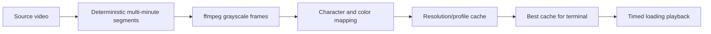

# Loading Animation

## Purpose

Long operations are more tolerable when the game acknowledges progress and presents a changing basketball highlight rather than a frozen terminal. [animation.py](../../../src/nba_gm_data/animation.py) converts video segments into colored ASCII frames and plays them during loading scopes.

## Pipeline

## Rendering Choices

- Terminal dimensions determine render size and aspect correction.
- Pixel brightness maps to characters; configurable text/random modes vary glyphs deterministically.
- Two foreground colors and optional gradient/background settings mimic the reference video-to-ASCII tool.
- ANSI truecolor is used where supported.
- Frames are precomputed and cached so loading playback does not invoke video decoding every time.

## Segment Selection

The full highlight video is divided into several multi-minute source segments. Loading screens choose a segment using seed/context rather than resume from one global cursor. This gives variety across screens and avoids looping only the short test clip.

The small clip remains useful for cache generation and visual iteration, but production defaults should select caches derived from the full video when installed.

## Smoothness

Playback timing should account for render time instead of sleeping a fixed full frame interval after rendering. Blank/gray flashes usually indicate clearing the terminal between frames or slow cache reads. The renderer minimizes disruptive clears and preloads selected frames.

## Asset Distribution

The full video exceeds GitHub's 100 MB normal-file limit. It is not committed directly. Friend-friendly installation uses a separately downloadable loading-assets archive/release and a command that installs/extracts it into the expected local directory. See [[Decisions/ADR-009 External Loading Assets]].

GitHub documents large-file options at [About large files on GitHub](https://docs.github.com/en/repositories/working-with-files/managing-large-files/about-large-files-on-github) and [Git LFS](https://docs.github.com/en/repositories/working-with-files/managing-large-files/about-git-large-file-storage).

## Failure Behavior

Loading animation is optional. Missing ffmpeg, source video, cache, truecolor, or terminal capability must not prevent gameplay. The context manager should yield to the operation and fall back to text/progress presentation.

## Invariants

- Animation never changes game state or randomness.
- A cache is tied to source identity and render profile.
- Long operations can complete even if animation setup fails.
- Selection can reach every installed full-video segment.
- Preview and gameplay use the same cache-selection logic.

## Alternatives

### Bundle The Full Video In Git

Rejected because normal GitHub pushes reject files above 100 MB and repository clones would become unnecessarily heavy.

### Decode Live During Every Load

Avoids cache storage but consumes CPU exactly when the engine is busy and increases visual stutter.

### Spinner Only

Much simpler and more portable, but loses the project's distinctive basketball presentation. It remains the appropriate fallback.

## Source Anchors

- [Animation module](../../../src/nba_gm_data/animation.py)
- [Loading asset installer tests](../../../tests/test_foundation.py)

