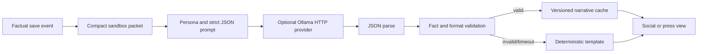

# Narrative Engine

## Purpose

The deterministic social and press templates became repetitive, context-poor, and visibly canned. [narrative.py](../../../src/nba_gm_data/narrative.py) adds an optional local Ollama writer while preserving one crucial boundary: the model writes language, not league reality.

## Architecture

Normal simulation does not call Ollama. Social posts are generated lazily when the social room is opened. Press content, when enabled, is generated only when the event is encountered. This protects simulation speed and keeps the game playable without a model.

## Provider Interface

`NarrativeProvider` defines a small generation protocol. The first real provider is `OllamaNarrativeProvider`, implemented with Python's standard-library HTTP tools. `FallbackNarrativeProvider` preserves deterministic operation on missing server, timeout, malformed JSON, unsupported model, or failed validation.

Settings include enabled state, provider, URL, model, timeout, maximum posts per view, and cache controls. The current defaults favor richer generation but remain user-configurable.

Ollama structured output is documented at [Ollama Structured Outputs](https://docs.ollama.com/capabilities/structured-outputs).

## Context Packets

Packets contain only facts the model is allowed to use, such as:

- in-game date and phase;
- event subject and structured details;
- involved teams and exact records;
- conference and standings slice;
- involved players' simulated team, age, position, ratings, recent line, games played, injury risk, and contract;
- exact future cap and hard-cap rows when relevant;
- roster/extension context for the same simulated team;
- recent related factual events.

Prompts explicitly forbid relying on real-life NBA memory. Names are not stripped because team and player relationships can be valuable context; instead, the packet supplies exact simulated relationships and validation rejects unsupported names or claims.

## Personas

Fixed personas provide stable voices without letting the model invent arbitrary sources:

- cap obsessive;
- film analyst;
- beat reporter;
- fan chaos;
- skeptical insider;
- stats analyst;
- draft obsessive.

Each persona receives style and stance guidance. Deterministic assignment and broad positive/neutral/negative stance balance reduce a timeline dominated by the same skeptical tone.

## Social Validation

Validation is domain-aware, not only schema-aware. It checks:

- supported team abbreviations and people;
- trade direction and asset ownership;
- exact contract AAV versus total value;
- conference membership and standings context;
- cap-pressure language against modeled cap/hard-cap posture;
- team rank versus player rating language;
- extension teammate context;
- unsupported real-world injury/reputation claims;
- repeated subject text, malformed brackets, truncation, and runaway length.

Evidence snippets can be appended when the generated opinion is useful but lacks an exact factual anchor. The social renderer wraps long posts rather than slicing them mid-thought, and visually distinguishes fallback text.

## Cache

Narrative cache keys include mode, source event ID, context hash, persona, provider/model settings, and prompt version. Cache entries are reused when the same event and context are viewed again. They invalidate when the underlying context or prompt/provider version changes.

This prevents repeated model latency and avoids rewriting the same historical post every time the room opens.

## Press Conferences

The model can produce a reporter, contextual question, four answer choices, hidden tone/effect tags, and rationale. Deterministic code validates exactly four answers, allowed effects, ambiguity, event relevance, and bounded morale/fan/owner effects before presenting it.

Forced press conferences are currently disabled by default to speed testing. The code and cache remain so the feature can return deliberately. Non-head-coach staff changes should not force a press event.

## Why Local LLM?

- No per-request cloud cost.
- Save context remains on the user's machine.
- Friends can run the game offline after installing a model.
- The game can support model choice and fallback.
- It demonstrates constrained generative-AI integration rather than delegating domain logic.

The costs are installation, model variability, latency on laptops, prompt/validator maintenance, and weaker outputs from small models. Faster models such as a 4B parameter local model can be used if prompts and JSON handling are model-agnostic.

## Invariants

1. Simulation advancement makes zero narrative-provider calls.
2. Generated language cannot create or mutate a trade, injury, contract, result, rating, or morale effect.
3. Unsupported names/teams/facts are rejected or repaired.
4. Cache reuse is deterministic for unchanged context.
5. Provider failure never prevents game progress.
6. Press effects are selected from bounded deterministic mappings, not free-form model numbers.

## Alternatives

### More Handwritten Templates

Fast and deterministic, but content grows combinatorially with event type and context. It remains the necessary fallback.

### Cloud LLM API

Likely stronger quality and easier setup for some users, but adds credentials, cost, internet dependency, privacy questions, and release support.

### Generate Narrative During Simulation

Historical context would be fresh, but month simulation would block on many calls. Lazy generation with preserved event facts is safer.

## Related Decision

[[Decisions/ADR-006 Optional Sandboxed Local LLM]].

