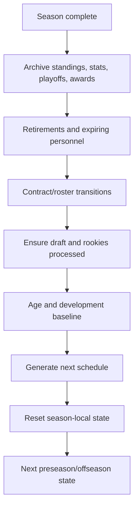

# Playoffs, Awards, And Rollover

## Playoff State

The save stores bracket rounds, series, game outcomes, active round, champion, playoff player stats, and Finals MVP context. The current GUI presents a tournament-style bracket rather than a flat list and exposes three simulation scopes:

- one game for every active unfinished series;
- the remainder of the current round/series flow;
- all remaining playoffs.

One “next game” action simulates one game for every unfinished series in the active round. Completed series wait; the next round begins only when all series in the current round finish.

## Why Every Active Series Advances Together

The user experiences playoff time by rounds. Simulating only one arbitrary series per click creates uneven chronology and makes “one game” ambiguous. Advancing each active series once preserves a coherent slate while allowing series to finish at different lengths.

## Playoff Dashboard Context

The team dashboard remains available whether the user's team is alive or eliminated. During play-in/playoffs, player rows should use playoff statistics and display that context explicitly. Rotation conversations remain legal only when relevant to a participating user team.

At the start of a new regular season, the dashboard returns to regular-season stats.

## Finals MVP

Finals MVP must be determined after the Finals are complete from Finals game-by-game production and influence. It is displayed beside the champion in the completed bracket state. Selecting it before the series ends or hiding it behind a menu that disappears after completion violates the lifecycle.

## Awards

`generate_league_awards` uses saved season statistics and contextual ratings. Award models require more than raw counting leaders:

- MVP balances production, impact, role, availability, and team context.
- DPOY must emphasize elite defensive traits and impact rather than reward a rebound/block accumulation anomaly.
- Rookie of the Year eligibility applies only to a player's first active season.

Awards are generated once and archived with the season.

## Rollover

Season rollover connects almost every system:

Order matters. Retirements before re-signing prevents a player from signing and immediately retiring. Drafted rookies need contracts and roster placement before next-season minimum/rotation setup. History must be preserved while counters and restrictions reset.

## Generated Future Schedule

The initial season can use researched schedule data; future seasons need deterministic generated schedules with valid teams, dates, home/away structure, and unique game IDs. Those games must flow through the same simulation context as initial-season games.

## Invariants

- Every playoff game belongs to one series and is applied once.
- A round advances only when all series are complete.
- Champion and Finals MVP exist only after Finals completion.
- ROTY winners are first-season players.
- One season's awards and histories are not recomputed differently after archive.
- Rollover creates a future schedule whose games can actually simulate.
- Expiring contracts, retirements, draft onboarding, and roster minimums happen in causal order.

## Performance Risk

Rollover is expected to be one of the slowest tests because it integrates the entire league and next-season generation. Optimize repeated work, not the existence of necessary transitions. See [[Quality/Performance and Optimization]].

## Source Anchors

- [Save lifecycle, playoff, awards, rollover](../../../src/nba_gm_data/save.py)
- [Draft onboarding](../../../src/nba_gm_data/draft.py)
- [Game simulation](../../../src/nba_gm_data/sim.py)

