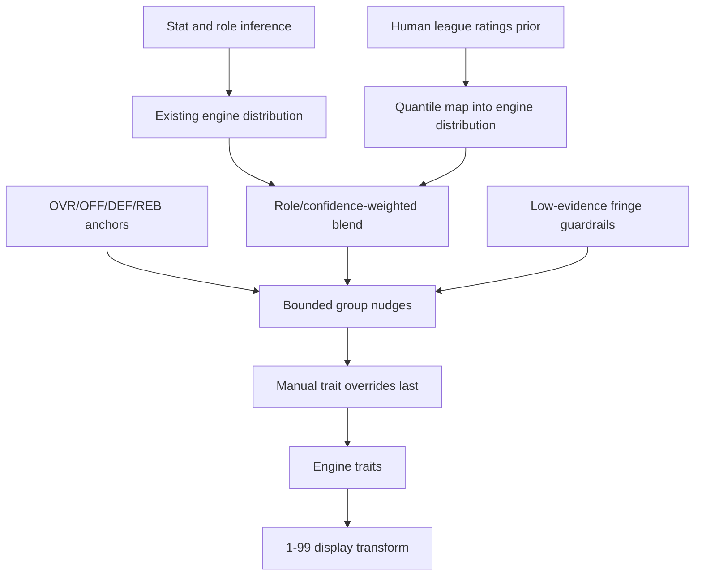

# Ratings And Traits

## Two Rating Languages

The project uses an internal engine trait scale and a user-facing display scale. They serve different purposes.

- **Engine values** preserve the distributions and relationships that existing simulation, trade, health, and draft formulas were tuned around.
- **Display values** rescale those values into a familiar 1-99 vocabulary so elite players can visibly reach the 90s.

Changing every engine rating to look like a sports game's display scale would silently alter thousands of thresholds and weights. Display translation improves intuition without throwing away calibrated behavior. See [[Decisions/ADR-008 Engine Ratings vs Display Ratings]].

## Canonical Traits

The league calibration source maps fifteen human-readable traits into existing engine traits:

| Trait | Basketball question |
|---|---|
| Release Speed | How quickly can the player get a viable shot off? |
| Shooting Range | How far must defenses respect the shot? |
| Shot Versatility | How many shot contexts can the player convert? |
| Rim Pressure | How strongly does the player bend defense toward the rim? |
| Handle Under Pressure | Can the player preserve advantage against ball pressure? |
| Passing Reads | Can the player recognize and execute the next pass? |
| Foot Speed | How much movement ground can the player cover? |
| Stamina | Can the player sustain workload and effectiveness? |
| Defensive Effort | How consistently does the player apply defensive activity? |
| Scheme IQ | Does the player make correct team-defense decisions? |
| Rim Deterrence | Does the player prevent or reduce efficient rim attempts? |
| Screen Navigation | Can the player survive perimeter screening actions? |
| Offensive Rebounding | Does the player create extra possessions on offense? |
| Portability | Does the player's value survive different roles and teammates? |
| Playoff Translation | How robust is the skill set under concentrated game planning? |

Composite views such as Overall, Offense, Defense, Spacing, Creation, Rebounding, Athleticism, Disruption, and Rim Protection are derived summaries. They are not all independent stored skills.

## Calibration Stack

The prior file lives at [league_trait_ratings_2026_06_20.csv](../../../data/overrides/league_trait_ratings_2026_06_20.csv). It is a subjective full-health prior, not an injury model and not a direct replacement for engine values.

## Why Quantile Mapping?

The human CSV uses a familiar rating scale whose absolute spacing was not designed for this engine. Quantile mapping asks, “Where does this player rank in the human prior?” and maps that rank into the existing trait distribution. It can reorder obvious anomalies while preserving league-wide mean, variance, and simulation scale.

Core/rotation players are pulled more strongly toward the prior. Fringe players with little evidence are pulled less and capped so unknown low-minute players do not become accidental superstars. Existing manual overrides apply last because they represent deliberate playtest corrections.

## Matching And Audit

Rows match by normalized name, then curated aliases such as `Ron Holland` to `Ronald Holland II` or `Carlton Carrington` to `Bub Carrington`. Ambiguous fuzzy matches are refused rather than guessed. Build output records matched, unmatched, team-mismatch, ambiguous, adjusted, and capped rows.

At the reviewed snapshot, the calibration matched 374 of 510 CSV rows, reported 136 CSV-only rows, 114 meaningful canonical players not present in the prior, zero ambiguous matches, 5,910 adjusted traits, and 300 capped fringe traits across 70 players.

## Consumers

- [[Systems/Simulation Engine]] uses trait and composite features for player/team behavior.
- [[Systems/Transactions and Asset Valuation]] uses present ability, role, age, fit, portability, contract, and context.
- [[Systems/Draft Lottery and Scouting]] generates and scouts prospect traits.
- [[Systems/Health Fatigue and Development]] changes individual traits over time.
- [[Systems/Contracts and Free Agency]] uses role and market valuation informed by performance/ability.
- [[Systems/Narrative Engine]] receives selected display ratings as evidence, never unstated reputation.

## Full Health Versus Availability

Ratings represent skill at full health. Availability, current injury, rust, durability, and recurrence risk live in the health model. This separation prevents one long injury from turning an elite player's basketball ability into a replacement-level rating. It also allows trade value to apply a bounded risk adjustment without forgetting who the player is.

## Known Limits

- Subjective priors still contain judgment errors and date quickly.
- Composite weights can make a plausible trait set produce a surprising overall.
- Generated future players must inhabit the same engine distributions without human priors.
- Display percentiles can exaggerate tiny engine differences at the tail unless transforms are bounded.
- Team results can remain plausible even when individual ratings are wrong, so standings alone are insufficient validation.

## Validation Approach

- Rank-order sanity for known archetypes and stars.
- Distribution comparisons by position and role.
- Player stat output over multiple seeds.
- Team feature-vector ranges before and after calibration.
- Awards sanity, especially DPOY and primary creator assists.
- Full suite checks to detect cross-system drift.

## Source Anchors

- [Ingestion and calibration](../../../src/nba_gm_data/ingest.py)
- [Schema](../../../src/nba_gm_data/schema.py)
- [Trait overrides](../../../data/overrides/trait_overrides.json)
- [Ratings prior](../../../data/overrides/league_trait_ratings_2026_06_20.csv)

