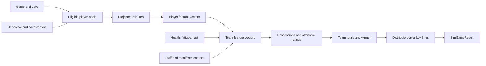

# Simulation Engine

## Responsibility

[sim.py](../../../src/nba_gm_data/sim.py) turns a dated matchup and active league state into a deterministic game result, team score, player box scores, probability explanation, and feature breakdown. It supports two modes:

- `replay-real-minutes` uses available real-minute context where appropriate.
- `sandbox-sim` uses the evolving save's roster, rotation, health, and context.

The engine is not a possession-by-possession basketball simulator. It is a feature-based probabilistic model that aims to produce credible team and player outcomes while staying fast enough for season simulation.

## Pipeline

## Player Features

Player features combine hidden engine traits and role context. They include shooting, spacing, rim pressure, creation, passing, rebounding, defensive activity, rim deterrence, athleticism, portability, usage, expected minutes, and role-specific modifiers.

The model needs both skill and opportunity. A great passer at eight minutes per game should not produce the same assists as a primary creator at 36 minutes. Conversely, minutes alone should not turn a weak creator into a league assist leader.

## Team Features

Team vectors aggregate rotation-weighted talent while preserving non-linear ideas such as:

- top-end creation and star power;
- lineup spacing and rim pressure;
- depth beyond the top players;
- point-of-attack and rim defense;
- rebounding and athletic pressure;
- availability dependence when a crucial player is missing;
- coach or staff context;
- team manifesto/strategy adjustments.

A pure average would undervalue stars and overvalue interchangeable depth. A pure top-player model would ignore lineup quality and injuries. The current mix represents both.

## Outcome Generation

The engine estimates pace/possessions and matchup-adjusted offensive output, then samples a deterministic pseudo-random outcome. Team totals constrain player totals, and player distributions are weighted by minutes, usage, and relevant traits. Overtime is handled after regulation when necessary.

Per-game variance was increased for player points, assists, and rebounds without allowing player-line randomness to detach from team totals. This distinction matters: realistic variance should redistribute a plausible team performance, not invent an impossible aggregate score.

## Context Reuse

`sim_game_with_context` accepts a preloaded context containing schedules, box scores, team/player indexes, coaches, and feature caches. `advance_save` loads it once for a range rather than reopening and renormalizing files for every game.

Canonical feature caches are guarded by object/list identity. Save mutations that change traits or rosters require a new or invalidated active canonical view. See [[Architecture/Persistence and Mutation Safety]].

## Determinism

A game RNG is seeded from stable context such as `seed:game_id:mode`. This enables exact replay of a failing simulation scenario. See [[Architecture/Determinism and Identity]].

## Calibration Philosophy

The model is calibrated at multiple levels:

1. Team sanity: strong rosters should usually outperform weak rosters.
2. League distribution: pace, scores, standings, and stat leaders should occupy plausible ranges.
3. Player truth: high-impact player roles and trait strengths should appear in output.
4. Tail behavior: stars can have exceptional games without every season producing impossible leader totals.
5. Stability: targeted corrections should avoid destroying already credible standings.

This is why changes such as reducing one star's scoring or boosting a primary creator's assists are preferably role- and trait-specific rather than global multipliers.

## Invariants

- Only players rostered to the participating teams and available on the date can receive new game logs.
- Player minute totals remain regulation-bounded unless overtime occurs.
- Team score and player scoring distributions remain coherent.
- Re-simulating the same game with the same state and seed produces the same result.
- Recent scoring context uses only games before the current game.
- A temporary injury changes availability and modestly affects future value, but does not rewrite healthy full-skill ratings.

## Alternatives

### Possession-Level Simulation

This could model lineups, substitutions, play types, and individual matchups more faithfully. It would require much more data, calibration, runtime, and debugging. The current project prioritizes league-scale GM behavior and multi-season speed.

### Pure Regression On Historical Box Scores

This might match first-season statistics but would struggle after trades, development, generated players, coaching changes, and future seasons where historical outcomes no longer exist.

### Overall-Rating Formula

Fast and simple, but it would erase the basketball-specific lineup interactions that make roster construction meaningful.

## Source And Tests

- [Simulation module](../../../src/nba_gm_data/sim.py)
- [Health integration](../../../src/nba_gm_data/health.py)
- [Foundation tests](../../../tests/test_foundation.py) - search for `sim_`, `probability`, `minutes`, `scoring`, `lineup`, and `box_score`.

## Related Notes

- [[Systems/Ratings and Traits]]
- [[Systems/Health Fatigue and Development]]
- [[Quality/Performance and Optimization]]

