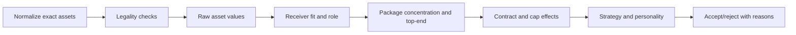

# Transactions And Asset Valuation

## Responsibility

[transactions.py](../../../src/nba_gm_data/transactions.py) models player and pick assets, team strategy, trade generation, package evaluation, legality, acceptance, application, pick protections, and pick swaps.

It is one of the hardest systems because “value” is not intrinsic. A player can be more valuable to one team because of role, timeline, need, depth, cap situation, and competitive phase. A pick can be more valuable to a rebuilding team or when its projected slot is uncertain. A package can be worse than the sum of its parts because five depth players do not replace one superstar roster slot.

## Valuation Layers

### Raw Player Value

Inputs include current on-court ability, age curve, development/potential, role, minutes and production, portability, contract surplus or burden, health history, and elite-player floors.

### Owner Context

Asset lists answer: “How valuable is this asset to its current team right now?” Team quality, timeline, role, and replacement depth matter.

### Receiver/Package Context

Trade inspection answers: “What does this incoming package do for this receiving team?” It includes fit, positional need, top-end talent, cap effects, role availability, depth saturation, and GM personality.

This is why the same pick or player may display a different number in an asset list and a trade response. The UI should label that context rather than imply inconsistency.

## Team Strategy

Front-office profiles and team strategies represent competitive phase, pressure, patience, risk tolerance, pick appetite, star appetite, financial posture, and positional/timeline needs. Team records and roster quality update the context over time.

Large assets face stronger justification requirements. AI should not include a franchise player, premium prospect, or elite pick merely because a scalar sum technically balances.

## Package Evaluation

`evaluate_trade` produces team-specific evaluations and structured explanations. `evaluate_trade_for_team` handles one receiving team's context. Acceptance should be explicit; being “near enough” in net value is not equivalent to consent.

## Legality

The v1 legality layer checks practical constraints including:

- asset ownership and duplicate assets;
- roster limits;
- salary/cap matching rules represented by the model;
- Stepien-style own-first availability;
- recently traded restrictions;
- recently signed restrictions through December;
- locked protection fallback collateral;
- already selected/current-draft pick constraints;
- valid pick obligation terms.

The model deliberately does not implement every NBA collective bargaining exception. See [[Data/Overrides and Model Configuration]].

## Trade Finder Versus Trade Builder

- **Builder:** user constructs both sides, then AI teams evaluate. The user can override their own advisor only when the partner accepts.
- **Finder/shop:** user chooses assets and terms first; AI generates incoming offers that must already be legal and partner-accepted. An offer surfaced as incoming must not be rejected a second time at apply.

Historical authorization bugs occurred because stored response records lost the distinction between an accepted finder offer, a rejected AI response, and a live user override. Application now needs provenance plus explicit acceptance, not merely legality.

## AI-AI Markets

AI trades run at chronological checkpoints in the regular season, draft, and free agency. They avoid silently involving user assets, enforce overlap protections, and generate news/events. Draft trades center on current picks and prospect fit; free-agency trades can clear space or pursue alternatives after a lost bidding war.

## Value Benchmarks

Reported real-world package shapes have been used as calibration examples, not hardcoded outcomes. A franchise/MVP player should require concentrated premium value; a high-end but imperfect star can plausibly return a strong young player, firsts, swaps, and seconds. Benchmarks test the shape and tier separation, while the sim's own team context remains authoritative.

## Invariants

1. A team can send only an asset it currently controls.
2. A trade applies only once and either updates all involved state or none.
3. A stored rejected offer cannot be applied.
4. A finder offer presented as accepted cannot be rejected again without state-changing invalidation.
5. User assets never enter silent AI-AI trades.
6. One exact current draft pick transfer changes only that pick ID.
7. Large move-ups, especially to pick #1, require real premium value rather than a token second.
8. Temporary injury should be a bounded concern; sustained recurrence history can be a meaningful penalty.

## Performance

Trade search evaluates many candidate packages. Rebuilding transaction context and pick projections for every candidate was wasteful. `with_transaction_context` and pick-value annotations now use signatures and internal caches for unchanged active state. Formulas and acceptance behavior remain unchanged. See [[Quality/Performance and Optimization]].

## Related Notes

- [[Systems/Pick Obligations and Swaps]]
- [[Systems/Contracts and Free Agency]]
- [[History/Failure Museum]]
- [[Decisions/ADR-005 Structured Pick Obligations]]

